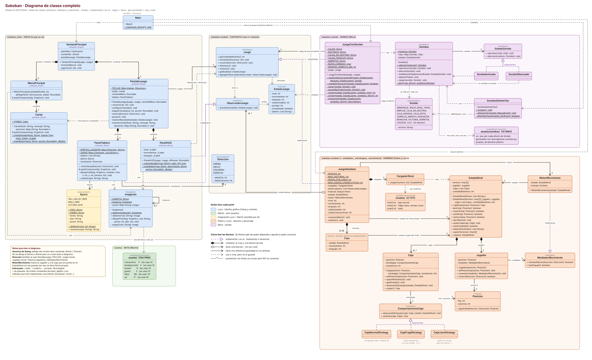
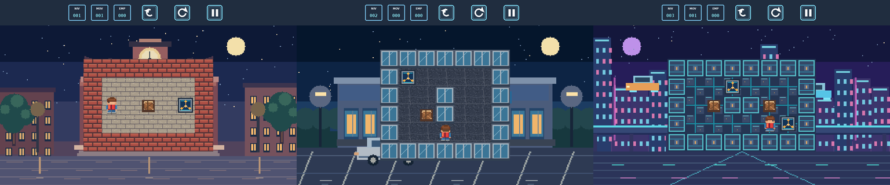

# Integración del proyecto: estado al 09/11/2026

Este documento junta las cuatro partes que ya están en el repositorio (arte, interfaz, dominio y sonido), dice quién hizo cada una, explica cómo se conectan y qué falta para entregar.

## Diagrama de clases completo



- Vectorial: [`uml/2-diagrama-completo.svg`](uml/2-diagrama-completo.svg). Además hay un diagrama por patrón (Observer, Facade, Singleton, Strategy, Mediator, Decorator, State y el deshacer con fotos), la vista general, MVC, cómo leer las flechas y un diagrama de secuencia (todos en [`uml/`](uml/)), y la [guía explicativa en PDF](guia/Guia-del-proyecto-Sokoban.pdf).
- Para regenerarlos: `python3 docs/uml/fuentes/diagramas.py` (las clases están en `clases.py`; la posición de cada caja y el recorrido de cada flecha, en `diagramas.py`). El de secuencia es PlantUML: `docs/uml/fuentes/7-secuencia-mover.puml`. La guía se regenera con `node docs/guia/generar-pdf.js`.
- Colores: **azul = Luca**, **verde = Martín**, **amarillo = integración**, **naranja = Pedro y Lucía**, **lila = Mora**.

## Quién hizo qué

| Parte | Autor | Archivos |
|---|---|---|
| Arte: personaje (4 direcciones), cajas, destinos, pisos y paredes por época, fondos 1955/1985/2015, botones e indicadores del HUD, diseños de pantallas | **Martín** | `assets/` (104 PNG) |
| README inicial y consigna | **Martín** | `README.md`, `docs/consigna-prof-pepe.pdf` |
| Interfaz gráfica Swing: ventana, menú, partida, HUD, tablero, carteles de pausa y resultado, caché de imágenes | **Luca** | `src/main/java/sokoban/vista/*` (salvo `Epoca`), `Main.java` |
| Contrato vista-dominio: `Juego` (Facade), `ObservadorJuego` (Observer), `EstadoJuego` (DTO), `Direccion` | **Luca** | `src/main/java/sokoban/modelo/` (esas 4) |
| Juego de prueba (se borró al unificar) | **Luca** | estaba en `src/main/java/sokoban/prueba/` |
| Proyecto Maven, documentación y UML de la interfaz | **Luca** | `pom.xml`, `docs/interfaz.md`, `docs/uml/diagrama-interfaz-sokoban.*`, `docs/capturas/` |
| Dominio y personaje: `JuegoSokoban`, `CargadorNivel`, `EstadoNivel`, `Posicion`, `Jugador`, `Caja`, las estrategias de caja (Strategy) y el motor de movimiento (Mediator), 5 símbolos nuevos en `PanelTablero` | **Pedro y Lucía** | `src/main/java/sokoban/modelo/` (el resto), `modelo/entidades/`, `modelo/estrategias/`, `modelo/movimiento/`, `niveles/` |
| Sonido: `JuegoConSonido` (Decorator), `Sonidos` (Singleton + Facade), `EstadoSonido` y sus dos estados (State), `Sonido`, `SonidosDeInterfaz`, 14 efectos generados por código | **Mora** | `src/main/java/sokoban/sonido/`, `assets/sonidos/`, `docs/generar_sonidos.py`, `docs/sonido.md`, 4 líneas de `Main` |
| Integración Luca + Martín (épocas, giro del personaje) | **Martín** (asistido por IA) | `vista/Epoca.java`, cambios en `PanelTablero` y `PantallaJuego` |
| Integración del dominio y del sonido, revisión, este documento y los diagramas | **Martín** | ver abajo |

## Cómo se conectan las partes ahora

```java
// Main.java: el único lugar que conoce las clases concretas
Juego juego = new JuegoConSonido(new JuegoSokoban());
new VentanaPrincipal(juego).setVisible(true);
SonidosDeInterfaz.instalar();
```

```
Main ─▶ VentanaPrincipal(juego) ─▶ PantallaJuego ─▶ juego (interfaz Juego)
                                                     │
                                         JuegoConSonido      (Decorator, sonido)
                                                     │  le pasa cada pedido a
                                         JuegoSokoban        (dominio)
                                           ├─ CargadorNivel ─▶ niveles/nivelN.txt
                                           ├─ EstadoNivel: terreno, Jugador, Caja (con su estrategia)
                                           ├─ MotorMovimiento (Mediator): mueve al Jugador y empuja la Caja
                                           ├─ historial de Fotos (deshacer 15 / 5 / 3)
                                           └─ observadores: PanelHUD y PanelTablero (Observer)
```

- **La vista solo conoce la interfaz `Juego`** (Facade + DIP). Por eso el dominio y el sonido entraron sin tocar la vista, salvo los 5 símbolos nuevos de `PanelTablero` (`f`, `G`, `g`, `K`, `c`).
- **El sonido no conoce al dominio**: `JuegoConSonido` envuelve «un `Juego`». Compara el `EstadoJuego` antes y después de cada acción y hace sonar el efecto que corresponde (paso, empuje, caja en destino, frágil dañada o rota, cerrojo, deshacer, reiniciar, victoria, derrota y choque).
- **Los observadores se registran a través del decorador**: `JuegoConSonido.agregarObservador` se lo pasa a `JuegoSokoban`, que es quien avisa después de cada cambio.
- **Ni el dominio ni la vista importan nada de `sokoban.sonido`**, y ni el dominio ni el sonido importan nada de `sokoban.vista`.
- **Un movimiento, en orden**: `PantallaJuego` → `JuegoConSonido` → `JuegoSokoban` (saca una foto) → `Jugador` → `MotorMovimiento` → `Caja` y su estrategia → `notificar()` a HUD y tablero → `Sonidos`. Ver [`uml/7-secuencia-mover.png`](uml/7-secuencia-mover.png).
- **Puntaje**: `max(0, 1000 - 10·movimientos - 5·empujes - 50·deshacer)`.

## Qué cambió en la integración

1. **Dominio (Pedro y Lucía).** Se unió la rama `main` con el dominio a la rama con el arte y la interfaz. Llegaron el paquete del dominio, la carpeta `niveles/` y un `<resource>` en `pom.xml` para meter los niveles en el `.jar`. En `Main` se cambió `new JuegoDePrueba()` por `new JuegoSokoban()`.
2. **`PanelTablero`.** El dominio traía su propia copia de `PanelTablero` (sin épocas ni giro del personaje). Se conservó la versión integrada (con `Epoca` y `mirarHacia`) y se le sumaron los 5 símbolos nuevos del dominio en el mapa `CAPAS`.
3. **Documentación recuperada.** Al copiar el ZIP del dominio se habían borrado los comentarios de documentación de `Juego`, `EstadoJuego`, `ObservadorJuego`, `Direccion` y `Main`. Se recuperaron, y el comentario de `Juego` ahora dice que la implementa `JuegoSokoban` y la decora `JuegoConSonido`.
4. **Sonido (Mora).** Se unió la rama `feature/sonido`: el paquete `sokoban.sonido`, los 14 `.wav` en `assets/sonidos/` (el `pom.xml` ya empaquetaba todo `assets/`) y 4 líneas de `Main` marcadas `[Sonido - M. Coghlan]`. La tecla **M** silencia y vuelve a activar el sonido.
5. **README.** Se actualizó con el equipo, la tecla M y la carpeta de niveles.
6. **Diagramas y guía.** Se reemplazaron las cajas grises *pendiente* por las clases reales, con un color por autor, y se agregaron los diagramas de Strategy, Mediator, Decorator, State y el deshacer.

Verificado: compila con `javac --release 17` y con `mvn package`, y se probó en pantalla con los tres niveles.

### Integración anterior (arte + interfaz)

- **Personaje con 4 direcciones**: `PanelTablero` dibuja `player_up`, `player_down`, `player_left` o `player_right` según la última flecha (gira aunque choque).
- **Tablero con el estilo de cada época**: el enumerado `Epoca` agrupa fondo, piso y pared; los niveles 1, 2 y 3 usan 1955, 1985 y 2015, y después se repiten. Para cambiar o agregar una época se modifica solo `Epoca` (OCP).

  

- **Ahora se usan 30 de las 104 imágenes**: las 28 de antes más la caja frágil dañada y el cerrojo abierto, que llegaron con el dominio.

## Cumplimiento de la consigna (probado)

Niveles `.txt` ✓ · caja normal, frágil y llave ✓ · piso resbaladizo ✓ · cerrojo y muros ✓ · deshacer 15 / 5 / 3 ✓ · victoria y paso al nivel siguiente ✓ · resumen con movimientos, empujes, deshacer y puntaje ✓ · HUD ✓ · sonidos propios de dominio público ✓ · imágenes ✓ · README ✓

## Revisión: para charlar en equipo

**Funciona bien y está bien diseñado**
- MVC con la vista separada del dominio por interfaces y un DTO inmutable (`EstadoJuego`).
- Siete patrones GoF con un motivo real: Observer (HUD y tablero), Facade (`Juego`, y `Sonidos` sobre `javax.sound`), Singleton (`Imagenes` y `Sonidos`), Strategy (las cajas), Mediator (el movimiento), Decorator (el sonido) y State (silencio con M). El deshacer guarda fotos del nivel, que es la idea de Memento.
- El sonido entró sin tocar el dominio ni la vista; el dominio entró sin tocar la vista (salvo símbolos).
- Si la PC no tiene audio, el juego sigue en silencio.

**Observaciones** (ninguna rompe el juego)
1. Al copiar el ZIP, el commit del dominio borró la documentación de `Juego`, `EstadoJuego`, `ObservadorJuego`, `Direccion` y `Main`. Ya se recuperó. Para la próxima conviene traer los cambios con una rama y un pull request.
2. `JuegoDePrueba` ya no se usaba: se borró el paquete `sokoban.prueba` al unificar todo en `main`.
3. Mediator: solo el `Jugador` usa el mediador; la `Caja` no. Para la defensa, o la Caja también pasa por él, o se explica por qué no.
4. El deshacer guarda fotos completas del nivel: se puede presentar como **Memento** si se nombra así en el informe.
5. Cuando la caja frágil se rompe y el nivel queda sin solución, solo suena «derrota»: no hay cartel que avise que hay que reiniciar.
6. Detalles visuales: la caja llave tapa el dibujo del cerrojo y el jugador sobre hielo tapa el hielo.
7. Los 3 niveles son de prueba y muy chicos.
8. Los dos commits del dominio tienen el mismo mensaje. Las notas del ZIP (`INTEGRACION_MEDIATOR_STRATEGY.md`) se pasaron a `docs/dominio.md`, sin las instrucciones de copiado.
9. El pull request del sonido quedó incorporado en `main`, y `main` ya tiene todo junto: arte, interfaz, épocas, dominio y sonido.

Detalles menores que pueden aparecer en la defensa: `JuegoSokoban` guarda el motor como `MotorMovimiento` aunque alcanza con la interfaz `MediadorMovimiento`; la caja llave abre **todos** los muros `X` del nivel (con un cerrojo por nivel da lo mismo); `JuegoConSonido` deduce qué pasó leyendo los símbolos del tablero, así que si el dominio cambia una letra hay que actualizar sus constantes.

## Lo que falta para la entrega (según la consigna)

- [x] Dominio completo: tablero, jugador, cajas normal/frágil/llave, piso resbaladizo, cerrojo y muros, niveles `.txt`, deshacer 15/5/3, puntaje.
- [x] Efectos de sonido.
- [ ] **Dos funcionalidades adicionales** que apliquen patrones de diseño. El silencio con la tecla M (State) podría contar como una; falta la otra.
- [ ] Diagrama de clases en **StarUML**.
- [ ] Informe técnico con decisiones de diseño y declaración del uso de IA.
- [ ] Video de gameplay.
- [ ] Mail al docente: lo manda un integrante, con copia al resto, con el nombre del equipo y el apellido y nombre de cada uno.
- [x] README con instrucciones para ejecutar.
