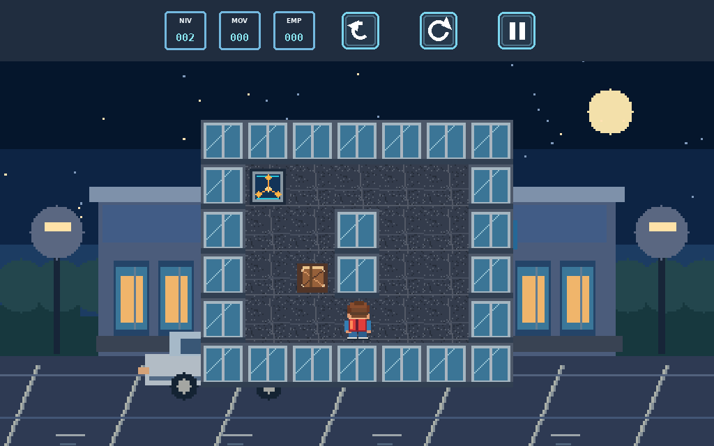
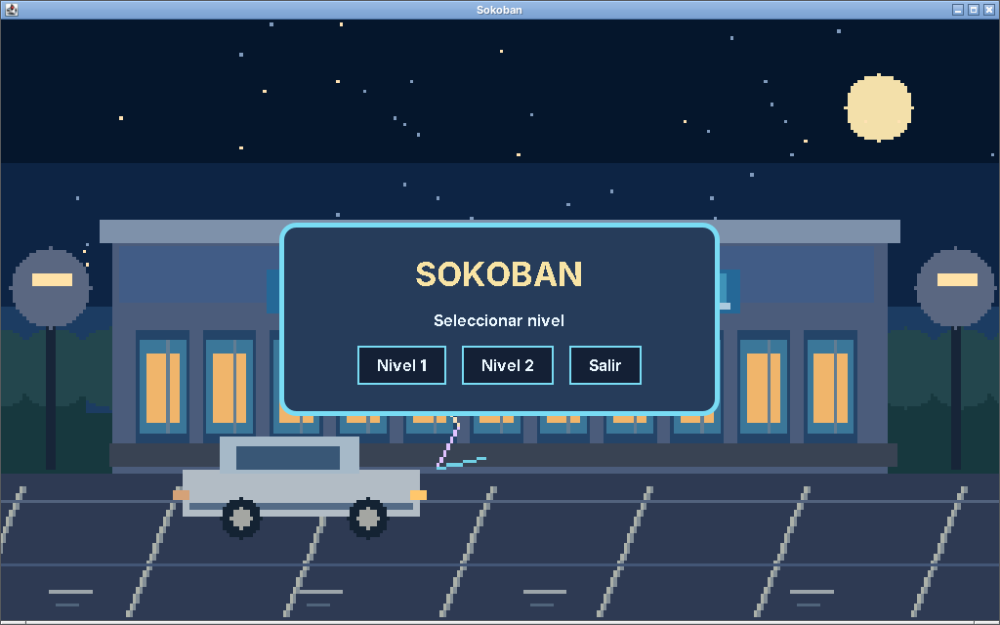
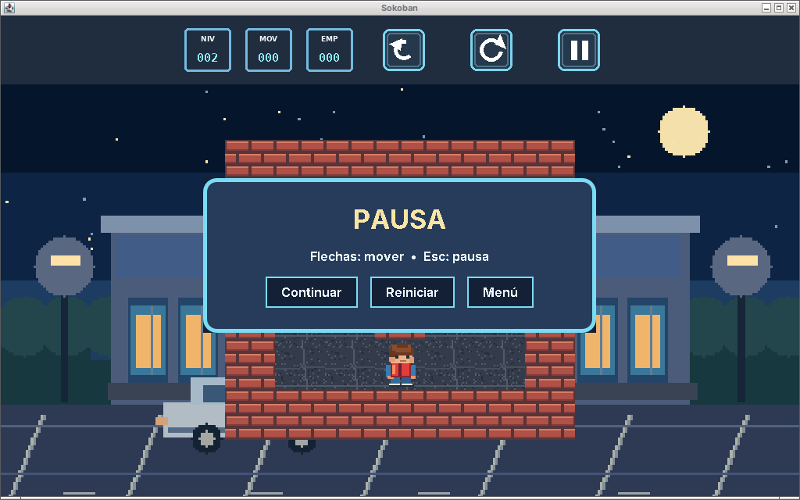
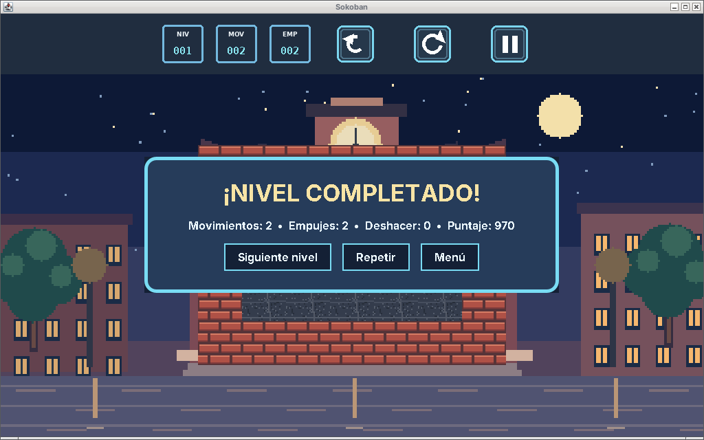
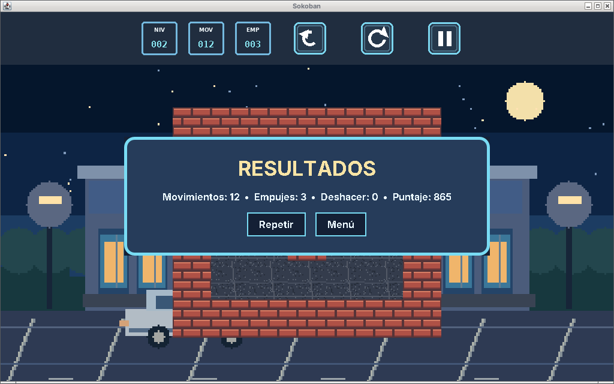
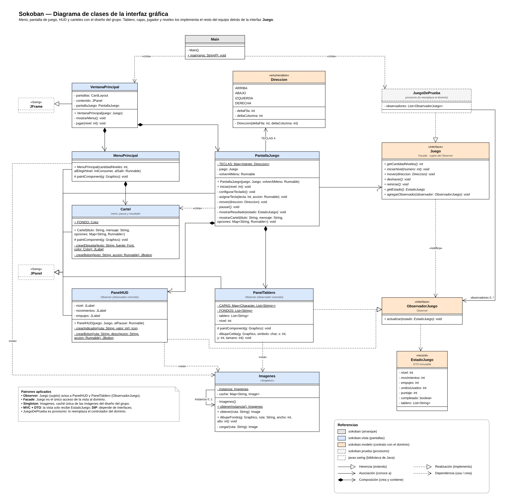

# Interfaz gráfica (Java Swing)

Esta parte del trabajo es solo la **interfaz gráfica** del Sokoban: menú principal, pantalla de juego con HUD y los carteles de pausa, nivel completado y resultados. Usa los diseños del grupo (fondos, íconos del HUD y sprites).

El dominio (tablero, cajas, jugador, niveles, deshacer, puntaje y sonidos) lo hace el resto del equipo detrás de la interfaz `Juego`. Mientras tanto, `JuegoDePrueba` simula un Sokoban mínimo de tres niveles (uno por época) para ver cómo responde la interfaz.

## Cómo ejecutarlo

Requisito: **Java 17 o superior**. Siempre se ejecuta desde la **raíz del repositorio**, porque las imágenes se leen de la carpeta `assets/`.

- **VS Code** (con la extensión *Extension Pack for Java*): abrir la carpeta del repositorio, abrir `src/main/java/sokoban/Main.java` y tocar **Run** arriba del `main`.
- **IntelliJ / Eclipse / NetBeans**: abrir la carpeta, que se importa como proyecto Maven, y ejecutar `sokoban.Main`.
- **Con Maven**: `mvn package` y después `java -jar target/sokoban.jar` (el .jar ya incluye las imágenes).

## Pantallas y controles

| Pantalla | Qué muestra | Opciones |
|---|---|---|
| Menú principal | Título y lista de niveles | Nivel 1 … Nivel N, Salir |
| Partida | HUD (nivel, movimientos, empujes) y tablero | Flechas para mover; botones Deshacer, Reiniciar y Pausa; **Esc** para pausar |
| Pausa | Cartel sobre la partida (el juego no recibe teclas) | Continuar, Reiniciar, Menú |
| Nivel completado | Movimientos, empujes, deshacer usados y puntaje | Siguiente nivel, Repetir, Menú |
| Resultados (último nivel) | El mismo resumen | Repetir, Menú |

| Menú | Pausa | Nivel completado | Resultados |
|---|---|---|---|
|  |  |  |  |

## Diseño

El diagrama de clases de la interfaz está en [`uml/diagrama-interfaz-sokoban.drawio`](uml/diagrama-interfaz-sokoban.drawio) (se abre con [diagrams.net](https://app.diagrams.net)) y en imagen en [`uml/diagrama-interfaz-sokoban.png`](uml/diagrama-interfaz-sokoban.png). Es la versión anterior a la integración con el arte de Martín.

> El diagrama **actualizado y completo** de todo el proyecto, con la autoría de cada parte, está en [`uml/2-diagrama-completo.png`](uml/2-diagrama-completo.png). Ver [`integracion.md`](integracion.md).

### Clases

| Paquete | Clase | Responsabilidad |
|---|---|---|
| `sokoban` | `Main` | Crea y conecta las clases concretas. |
| `sokoban.vista` | `VentanaPrincipal` | Ventana (`JFrame`) que cambia entre el menú y la partida con un `CardLayout`. |
| | `MenuPrincipal` | Menú de selección de nivel y Salir. |
| | `PantallaJuego` | Arma la partida, traduce las teclas en movimientos y muestra los carteles de pausa y resultado. |
| | `PanelHUD` | Indicadores de nivel, movimientos y empujes, y botones Deshacer, Reiniciar y Pausa. |
| | `PanelTablero` | Dibuja el tablero con las imágenes del grupo (piso, pared y fondo de la época del nivel) y el personaje mirando hacia donde se movió. |
| | `Epoca` | Enumerado: fondo, piso y pared de cada época (1955, 1985, 2015). Los niveles las van rotando. |
| | `Cartel` | Recuadro reutilizable con título, mensaje y botones (menú, pausa, resultados). |
| | `Imagenes` | Carga las imágenes una sola vez y las comparte. |
| `sokoban.modelo` | `Juego` | Contrato con el dominio: lo que la vista le puede pedir. |
| | `ObservadorJuego` | Contrato para las partes de la vista que se actualizan solas. |
| | `EstadoJuego` | Datos que la vista recibe del dominio (DTO). |
| | `Direccion` | Enumerado: arriba, abajo, izquierda y derecha. |
| `sokoban.prueba` | `JuegoDePrueba` | **Provisorio**: un Sokoban mínimo para probar la interfaz. |

### Patrones de diseño (solo donde hacen falta)

- **Observer** (comportamiento). Cuando el jugador se mueve, deshace o reinicia, el HUD y el tablero se tienen que actualizar. `Juego` es el sujeto y avisa a todos sus `ObservadorJuego` (`PanelHUD` y `PanelTablero`). El dominio no conoce a la vista. Para sumar algo que reaccione a los cambios (por ejemplo, sonido) se agrega otro observador sin tocar lo que ya existe.
- **Facade** (estructural). La vista necesita pocas operaciones: iniciar nivel, mover, deshacer y reiniciar. `Juego` es el único punto de acceso al dominio, que por detrás coordina tablero, historial, puntaje, etc.
- **Singleton** (creacional). Varias pantallas dibujan las mismas imágenes. `Imagenes` tiene una única caché compartida, así cada archivo se lee del disco una sola vez.

### MVC, principios y buenas prácticas

- **MVC**: la vista solo muestra datos y captura acciones. El dominio está detrás de `Juego` y se comunica con la vista solo mediante el DTO `EstadoJuego`, un `record` inmutable. La vista nunca recibe un `Tablero` ni una `Caja`.
- **SOLID**
  - **SRP**: cada clase tiene una sola tarea (ver la tabla de clases).
  - **OCP**: un observador, una tecla o un símbolo de tablero nuevo se agregan sin modificar el código existente.
  - **LSP**: `JuegoDePrueba` y el controlador real son intercambiables.
  - **ISP**: `ObservadorJuego` tiene un solo método.
  - **DIP**: la vista depende de interfaces y solo `Main` conoce las clases concretas.
- **GRASP**
  - **Creador**: `VentanaPrincipal` crea sus pantallas y `PantallaJuego` crea el HUD y el tablero.
  - **Controlador**: el controlador del dominio implementa `Juego`.
  - **Polimorfismo**: los observadores.
  - **Bajo acoplamiento**: las pantallas se avisan con `Runnable` / `IntConsumer` y no se conocen entre sí.
  - **Alta cohesión**: cada clase hace una sola cosa.
- **Code smells evitados**
  - **Switch statements**: las teclas y los símbolos del tablero están en mapas (`TECLAS`, `CAPAS`).
  - **Código duplicado**: menú, pausa y resultados usan el mismo `Cartel`.
  - **Primitive obsession**: se usa el enumerado `Direccion`.
  - **Large class / Long method**: no hay clases grandes ni métodos largos.
  - **Números mágicos**: están reemplazados por constantes.
  - El único constructor largo es el del `record` `EstadoJuego`, que es un DTO.

> En el UML se muestran las constantes que definen comportamiento (`TECLAS`, `CAPAS`, `SPRITES_JUGADOR`) y se omiten las de estilo (colores, fuentes, tamaños), los getters y los métodos que solo implementan la interfaz (`actualizar` en los observadores), según las reglas de la cátedra.

## Cómo agregar algo nuevo

| Quiero agregar… | Dónde |
|---|---|
| Una opción en un cartel (menú, pausa, resultado) | Una entrada más en el mapa de opciones de `MenuPrincipal` o `PantallaJuego`. |
| Una tecla | Una línea en `PantallaJuego.configurarTeclado()` (o en `TECLAS` si es una dirección). |
| Un elemento del tablero | Su símbolo en `PanelTablero.CAPAS` y su imagen en `assets/` (raíz del repo). |
| Una época nueva (fondo, piso y pared) | Una constante más en `Epoca`. |
| Un dato en el HUD (por ejemplo, tiempo) | El campo en `EstadoJuego` y un indicador más en `PanelHUD.actualizar()`. |
| Algo que reaccione a cada movimiento (por ejemplo, sonido) | Una clase que implemente `ObservadorJuego`, registrada con `juego.agregarObservador(...)`. |
| Una pantalla nueva | Un panel más en el `CardLayout` de `VentanaPrincipal`. |

## Integración con el dominio (para el resto del equipo)

1. El controlador del dominio implementa `Juego` (incluye `getCantidadNiveles()`, que usa el menú).
2. Después de cada cambio (mover, deshacer, reiniciar o iniciar nivel) llama a `actualizar(getEstado())` en cada observador registrado.
3. En `Main` se reemplaza `new JuegoDePrueba()` por el controlador real y se borra el paquete `sokoban.prueba`. No hay que tocar ninguna clase de la vista.

**Símbolos del tablero** (`EstadoJuego.tablero()`, una línea de texto por fila, como en los archivos de nivel):

| Símbolo | Elemento | Símbolo | Elemento |
|---|---|---|---|
| `#` | pared | `*` | caja en destino |
| ` ` | piso | `F` | caja frágil |
| `.` | destino | `L` | caja llave |
| `@` | jugador | `~` | piso resbaladizo |
| `+` | jugador en destino | `C` | cerrojo |
| `$` | caja | `X` / `O` | muro cerrado / abierto |

Los símbolos extra (`F`, `L`, `~`, `C`, `X`, `O`) son una propuesta y hay que acordarlos con el dominio. Si el nivel se lee de otro formato (no TXT), el dominio igual le pasa a la vista estas líneas de texto, así que la interfaz no cambia.

Las imágenes se toman de la carpeta `assets/` del repositorio (`backgrounds`, `boxes`, `characters`, `goals`, `tiles`, `ui`); la interfaz usa 28 de ellas y no duplica ninguna.

## Uso de herramientas de IA

La consigna pide declarar el uso de IA en el informe técnico. Completar acá qué partes se hicieron con asistencia de IA y cómo las revisó el equipo.
