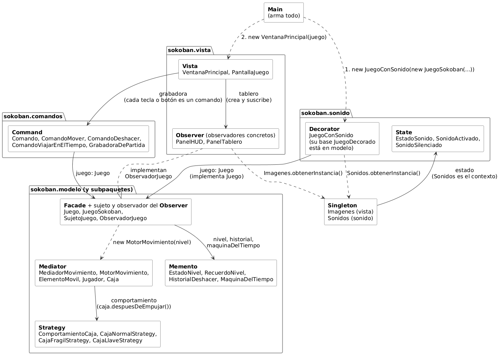

# Mapa de los patrones del Sokoban

## 1. Una frase

Son 9 patrones y se conectan en una sola cadena: `Main` arma el juego, la vista convierte cada tecla en un **comando**, el comando le habla al juego **decorado** con sonido, la **fachada** reparte el trabajo entre el **mediador** (con sus **estrategias**) y los cuidadores del **memento**, y al final avisa a los **observadores** de la vista. Imágenes y sonidos salen de dos **singleton**, y el sonido tiene dos **estados**.

## 2. Diagrama



Fuente: `0-mapa.puml`. Cada caja es un patrón (no una clase) y adentro dice qué clases lo forman. Cada línea es una relación real entre clases de las dos cajas: llena si es un atributo (la etiqueta dice cuál), punteada si es un `new`, una llamada o una variable local, y punteada con triángulo si implementa una interfaz.

## 3. Quién hizo qué

| Patrón | Integrante | Clases principales | Ficha |
|---|---|---|---|
| Facade | Luca | `Juego`, `JuegoSokoban` | [1-facade.md](1-facade.md) |
| Observer | Luca | `SujetoJuego`, `JuegoSokoban`, `ObservadorJuego`, `PanelHUD`, `PanelTablero` | [2-observer.md](2-observer.md) |
| Singleton | Luca (`Imagenes`) y Mora (`Sonidos`) | `Imagenes`, `Sonidos` | [3-singleton.md](3-singleton.md) |
| Strategy | Pedro y Lucía | `Caja`, `ComportamientoCaja` y 3 estrategias | [4-strategy.md](4-strategy.md) |
| Mediator | Pedro y Lucía | `MediadorMovimiento`, `MotorMovimiento`, `ElementoMovil`, `Jugador`, `Caja` | [5-mediator.md](5-mediator.md) |
| Decorator | Mora | `JuegoDecorado`, `JuegoConSonido` | [6-decorator.md](6-decorator.md) |
| State | Mora | `Sonidos`, `EstadoSonido`, `SonidoActivado`, `SonidoSilenciado` | [7-state.md](7-state.md) |
| Memento | Martín | `EstadoNivel`, `RecuerdoNivel`, `HistorialDeshacer`, `MaquinaDelTiempo` | [8-memento.md](8-memento.md) |
| Command | Martín | `Comando`, 3 comandos, `GrabadoraDePartida` | [9-command.md](9-command.md) |

## 4. Cómo se arma todo (`Main.java`, líneas 25 a 27)

```java
Juego juego = new JuegoConSonido(new JuegoSokoban(new CargadorNivel(carpeta)));
new VentanaPrincipal(juego).setVisible(true);
SonidosDeInterfaz.instalar();
```

`Main` es el único lugar que nombra clases concretas del modelo y del sonido. El resto del programa recibe un `Juego`.

## 5. Qué pasa cuando apretás una flecha (todos los patrones juntos)

1. **Command:** `PantallaJuego` crea un `ComandoMover` y la `GrabadoraDePartida` lo ejecuta y lo guarda.
2. **Decorator:** el comando llama `juego.mover(...)`. `juego` es el `JuegoConSonido`, que se lo pasa al `JuegoSokoban`.
3. **Facade:** `JuegoSokoban.mover` saca una foto del nivel (**Memento**) y le pide al nivel que mueva al jugador (`nivel.moverJugador`).
4. **Mediator:** el `Jugador` le pide a `MotorMovimiento` que lo mueva; el mediador, que tiene al jugador y a las cajas, resuelve paredes, hielo y empujes.
5. **Strategy:** si empujó una caja, la caja delega en su `ComportamientoCaja` (normal, frágil o llave), que le avisa algo al mediador.
6. **Memento:** de vuelta en la fachada, la foto va a `HistorialDeshacer`; si una caja llegó a un destino, otra foto va a `MaquinaDelTiempo`.
7. **Observer:** la fachada recorre su lista de `ObservadorJuego` y avisa a `PanelHUD` y `PanelTablero`, que se redibujan con imágenes de **Singleton** `Imagenes`.
8. **Decorator + Singleton + State:** de vuelta en `JuegoConSonido`, pide el sonido del evento a `Sonidos` (Singleton), que le pregunta a su estado (activado o silenciado) si suena.

## 6. Dos preguntas que suelen hacer

- **¿Por qué el sonido es un Decorator y no un Observer?** Porque en un choque el modelo no avisa a los observadores (no cambió nada que dibujar), pero el choque tiene que sonar. El decorador se entera de cada pedido. Ver ficha 6.
- **¿Por qué deshacer es Memento y no el `deshacer()` del Command?** Porque revertir a mano una caja rota, un muro abierto o un deslizamiento en el hielo es frágil; volver a una foto es exacto. El Command se usa para la repetición. Ver fichas 8 y 9.

## 7. Cómo comprobarlo vos

`mvn test` corre las 24 pruebas: `ReglasTest` (17), `EventosTest` (3), `NivelesTest` (3) y `RepeticionTest` (1). Ninguna abre una ventana: eso solo es posible porque el dominio no conoce la vista (Facade + Observer). Cada ficha dice qué prueba mirar.
