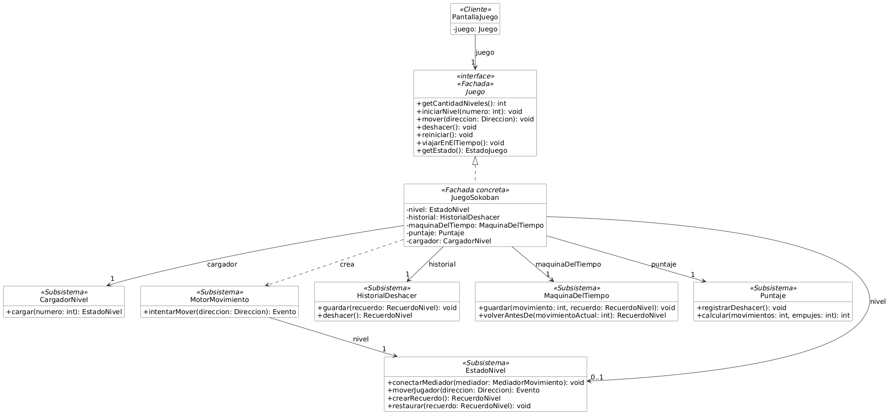

# Facade en el Sokoban

**Integrante:** Luca

## 1. Una frase

La vista quiere cosas simples (mover, deshacer, viajar, reiniciar) y no quiere saber que detrás hay un nivel, un mediador, dos cuidadores de recuerdos, un puntaje y un cargador de archivos. `Juego` es la puerta única y `JuegoSokoban` reparte cada pedido entre esas clases.

## 2. Diagrama



Fuente: `1-facade.puml`. Las clases «Subsistema» están en tres paquetes (`modelo`, `modelo.movimiento` y `modelo.tiempo`), así que no se dibujan dentro de un paquete.

## 3. Igual que en la materia

| Rol clásico | En el Sokoban | Archivo |
|---|---|---|
| Fachada | `Juego` (interfaz con las 7 operaciones del juego) | `modelo/Juego.java` |
| Fachada (la que trabaja) | `JuegoSokoban` | `modelo/JuegoSokoban.java` |
| Clases del subsistema | `CargadorNivel`, `EstadoNivel`, `MotorMovimiento`, `HistorialDeshacer`, `MaquinaDelTiempo`, `Puntaje` | `modelo/`, `modelo/movimiento/`, `modelo/tiempo/` |
| Cliente | `PantallaJuego` (y `VentanaPrincipal`, que solo pide `getCantidadNiveles()`) | `vista/` |

En la materia la fachada suele ser una sola clase. Acá está partida en interfaz (`Juego`) y clase (`JuegoSokoban`) para que el Decorator pueda envolverla (ver ficha 6).

## 4. El código, en el orden en que pasa

**a) La puerta única.** `Juego.java`, líneas 7 a 22:

```java
public interface Juego extends SujetoJuego {
    int getCantidadNiveles();
    void iniciarNivel(int numero);
    void mover(Direccion direccion);
    void deshacer();
    void reiniciar();
    void viajarEnElTiempo();
    EstadoJuego getEstado();
}
```

**b) La fachada tiene a todo el subsistema adentro.** `JuegoSokoban.java`, líneas 18 a 24:

```java
private final CargadorNivel cargador;
// ...
private final HistorialDeshacer historial = new HistorialDeshacer();
private final MaquinaDelTiempo maquinaDelTiempo = new MaquinaDelTiempo();
private final Puntaje puntaje = new Puntaje();
private EstadoNivel nivel;
```

**c) Arrancar un nivel: cuatro clases en una sola llamada.** `JuegoSokoban.java`, líneas 152 a 163. En orden: el `CargadorNivel` arma el nivel, se crea el mediador (`MotorMovimiento`) y se conecta, los dos cuidadores del Memento (deshacer y DeLorean) empiezan vacíos y el `Puntaje` vuelve a cero:

```java
private void cargar(int numero) {
    // ... valida el número
    numeroNivel = numero;
    nivel = cargador.cargar(numero);
    nivel.conectarMediador(new MotorMovimiento(nivel));
    historial.olvidarTodo();
    maquinaDelTiempo.olvidarTodo();
    maquinaDelTiempo.guardar(0, nivel.crearRecuerdo());
    puntaje.reiniciar();
}
```

**d) Deshacer: la vista llama un método y la fachada coordina tres clases.** `JuegoSokoban.java`, líneas 87 a 98:

```java
public void deshacer() {
    RecuerdoNivel recuerdo = enJuego() ? historial.deshacer() : null;
    if (recuerdo == null) {
        evento = Evento.CHOQUE;
        return;
    }
    nivel.restaurar(recuerdo);
    maquinaDelTiempo.olvidarDespuesDe(nivel.getMovimientos());
    puntaje.registrarDeshacer();
    evento = Evento.DESHACER;
    notificarObservadores();
}
```

**e) El cliente solo ve `Juego`.** `PantallaJuego.java`, línea 47, y los únicos `import` del modelo son `Direccion`, `EstadoJuego` y `Juego` (líneas 27 a 29):

```java
private final Juego juego;
```

## 5. Qué pasa cuando apretás "Deshacer"

1. El botón del HUD llama a `PantallaJuego.deshacer()`, que arma un `ComandoDeshacer` (ficha 9).
2. El comando llama `juego.deshacer()`. La vista no sabe nada más.
3. `JuegoSokoban.deshacer()` le pide un recuerdo a `HistorialDeshacer`.
4. Se lo da a `EstadoNivel.restaurar(...)`.
5. Le avisa a `MaquinaDelTiempo` que olvide los puntos del "futuro" que se borró.
6. `Puntaje` suma un deshacer usado (descuenta 50 puntos).
7. Avisa a los observadores y el HUD y el tablero se redibujan (ficha 2).

## 6. Por qué así y no de otra forma

| Alternativa | Por qué no |
|---|---|
| Que `PantallaJuego` use directo `EstadoNivel`, `HistorialDeshacer`, `MaquinaDelTiempo` y `Puntaje` | La vista tendría que saber el orden exacto de los pasos 3 a 6. Alto acoplamiento: cualquier cambio de reglas obliga a tocar Swing. Rompe SRP (la pantalla haría de pantalla y de motor). |
| Que la vista conozca `JuegoSokoban` en vez de `Juego` | Depende de una clase concreta (rompe DIP) y no se podría poner el `JuegoConSonido` en el medio. |
| Una fachada sin interfaz, pero con métodos estáticos | No se puede decorar ni reemplazar en pruebas. |

## 7. Code smells

| Smell | Dónde | ¿Justificado? Arreglo |
|---|---|---|
| **La fachada tiene reglas, no solo delega.** `mover` decide cuándo es `CAJA_EN_DESTINO`, cuándo es `VICTORIA` y cuándo guardar un punto en el tiempo. | `JuegoSokoban.java`, líneas 62 a 84 | **A medias.** En GoF la fachada solo reparte. Son reglas que cruzan varias clases del subsistema, así que algún lugar las tiene que coordinar. Si crece, pasarlas a una clase `ReglasDelNivel`. |
| **Tres roles en una clase:** fachada, sujeto concreto del Observer y componente concreto del Decorator. | `JuegoSokoban` | **Sí, por ahora.** Son 168 líneas. Si crece, la lista de observadores podría ir a una clase aparte. |
| **La interfaz de la fachada expone `notificarObservadores()`**, porque `Juego` hereda de `SujetoJuego`. Cualquier cliente podría forzar un aviso. | `Juego.java`, línea 7 | **A medias.** Es la estructura del Observer de la materia (el sujeto tiene notificar público). Nadie de afuera lo llama. |
| **`evento` es estado del "último pedido"**: el decorador lo lee después con `getEstado()`. Si alguien llama dos acciones seguidas sin leer, se pierde el primero. | `JuegoSokoban.java`, línea 26 | **Sí.** Es la forma de pasarle el resultado al sonido sin que el dominio conozca el sonido. |
| La fachada crea sus clases con `new` (solo el cargador se inyecta) | líneas 21 a 23 y 158 | **Sí.** El juego tiene una sola configuración. Para probar con dobles habría que inyectarlas. |
| `getEstado()` arma una foto completa (con el tablero copiado) y se llama 4 veces por movimiento | `PantallaJuego` líneas 84 y 87, `notificarObservadores` línea 144, `JuegoConSonido` línea 57 | **Sí.** El tablero es chico. |

## 8. Lista de chequeo

- [x] Hay una interfaz simple para un subsistema complejo: `Juego`.
- [x] La fachada conoce y usa a las clases del subsistema: `JuegoSokoban.cargar`, `mover`, `deshacer`, `viajarEnElTiempo`.
- [x] El cliente usa solo la fachada: `PantallaJuego` importa `Juego`, nunca `EstadoNivel` ni `HistorialDeshacer`.
- [x] Las clases del subsistema no conocen a la fachada: ninguna clase de `modelo/movimiento`, `modelo/tiempo`, `EstadoNivel`, `Puntaje` o `CargadorNivel` nombra a `Juego` ni a `JuegoSokoban`.
- [x] El subsistema se puede usar directo si hace falta: `ReglasTest` crea un `EstadoNivel` suelto (línea 182).

## 9. Cómo comprobarlo vos

- **Pruebas:** `ReglasTest` y `NivelesTest` juegan todo el Sokoban usando solo los métodos de la fachada (`mover`, `deshacer`, `viajarEnElTiempo`, `getEstado`). Por ejemplo `ReglasTest.deshacerVuelveCincoMovimientosHastaTresVecesSeguidas`. Se corren con `mvn test`.
- **Experimento:** buscá `import sokoban.modelo` en la carpeta `vista/`. Solo aparecen `Juego`, `EstadoJuego`, `Direccion` y `ObservadorJuego`.
