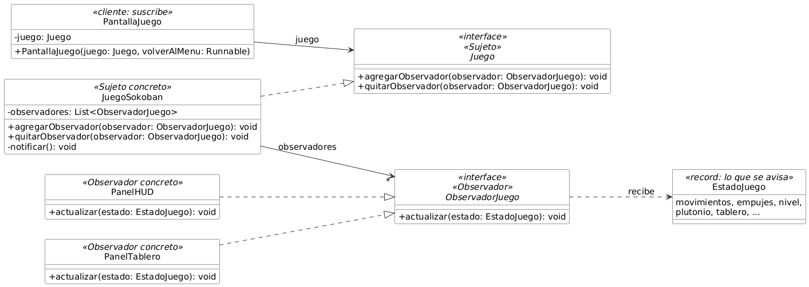

# Observer en el Sokoban: cómo está aplicado

**En una frase:** cuando cambia la partida (moverse, deshacer, viajar, empezar un nivel), el HUD y el tablero se redibujan solos. El dominio no sabe que existen: solo conoce la interfaz `ObservadorJuego`.



## 1. Quién es quién

| Rol del patrón | En el Sokoban | Archivo |
|---|---|---|
| Sujeto (interfaz con suscribir y desuscribir) | `Juego`: `agregarObservador`, `quitarObservador` | `modelo/Juego.java` |
| Sujeto concreto (guarda la lista y avisa) | `JuegoSokoban`: lista `observadores` y `notificar()` | `modelo/JuegoSokoban.java` |
| Observador (interfaz) | `ObservadorJuego`: `actualizar(EstadoJuego)` | `modelo/ObservadorJuego.java` |
| Observadores concretos | `PanelHUD` y `PanelTablero` | `vista/` |
| Lo que se avisa | `EstadoJuego`: una foto inmutable (record) de la partida | `modelo/EstadoJuego.java` |
| Quién suscribe | `PantallaJuego`, en su constructor | `vista/PantallaJuego.java` |

## 2. El código, en el orden en que pasa

**a) Suscribirse.** `PantallaJuego` crea los dos paneles y los anota en el juego (`PantallaJuego.java`, líneas 69 a 71):

```java
PanelHUD hud = new PanelHUD(this::deshacer, this::reiniciar, this::viajarEnElTiempo, this::pausar);
juego.agregarObservador(hud);
juego.agregarObservador(tablero);
```

**b) El sujeto guarda la lista** (`JuegoSokoban.java`, líneas 24 y 150 a 158):

```java
private final List<ObservadorJuego> observadores = new ArrayList<>();

public void agregarObservador(ObservadorJuego observador) {
    observadores.add(observador);
    if (estado != null) observador.actualizar(getEstado()); // si ya hay partida, le manda la foto actual
}

public void quitarObservador(ObservadorJuego observador) {
    observadores.remove(observador);
}
```

**c) Avisar** (`JuegoSokoban.java`, líneas 181 a 184). Se llama al final de `iniciarNivel`, `mover`, `deshacer` y `viajarEnElTiempo`; `reiniciar` pasa por `iniciarNivel`:

```java
private void notificar() {
    EstadoJuego foto = getEstado();                          // una sola foto para todos
    for (ObservadorJuego obs : observadores) obs.actualizar(foto);
}
```

**d) Cada observador reacciona a su manera.** El HUD redibuja los números (`PanelHUD.java`, línea 60):

```java
public void actualizar(EstadoJuego estado) {
    movimientos.setIcon(crearIndicador("ui/indicador_movimientos", estado.movimientos()));
    // ... nivel, empujes, plutonio y si el botón del DeLorean se puede usar
}
```

El tablero guarda las letras y se repinta (`PanelTablero.java`, línea 68):

```java
public void actualizar(EstadoJuego estado) {
    tablero = estado.tablero();
    epoca = Epoca.delNivel(estado.nivel());
    repaint();
}
```

## 3. Qué pasa cuando apretás una flecha

1. `PantallaJuego` recibe la tecla y le pide a `juego.mover(DERECHA)`.
2. `JuegoSokoban.mover` aplica las reglas. Si el movimiento se pudo hacer, llama a `notificar()`. Si chocaste contra una pared no cambia nada y no avisa.
3. `notificar()` arma una `EstadoJuego` y se la pasa a cada observador.
4. `PanelHUD` actualiza los contadores y `PanelTablero` se repinta.

`JuegoSokoban` nunca nombra a `PanelHUD` ni a `PanelTablero`.

## 4. Por qué así y no de otra forma

| Alternativa | Por qué no |
|---|---|
| Que `JuegoSokoban` llame directo a `hud.actualizar()` y `tablero.repaint()` | El dominio dependería de clases de Swing. Es acoplamiento a clases concretas, rompe MVC y DIP, y el juego no se podría probar sin pantalla (nuestras 23 pruebas corren sin ventana justamente por esto). |
| Que la vista pregunte cada tantos milisegundos si cambió algo (un `Timer`) | Trabaja aunque no pase nada y la vista no sabe cuándo cambió. |
| Pasarle al observador el `EstadoNivel` (el tablero real con `Caja` y `Jugador`) | La vista podría tocar el dominio y saltearse las reglas. Por eso viaja una foto inmutable (`record`). |
| Avisar sin datos y que el observador llame a `getEstado()` (modelo *pull*) | También sería válido. Elegimos mandar la foto (*push*) porque todos reciben exactamente la misma. |

## 5. Code smells que deja y si están justificados

| Smell | Dónde | ¿Justificado? |
|---|---|---|
| Interfaz ancha: `Juego` es a la vez la fachada (acciones del juego) y el sujeto del Observer (suscribir y desuscribir). Son 9 métodos que mezclan dos responsabilidades (ISP). | `Juego` | **Parcialmente.** La vista necesita un solo punto de entrada. Si el profesor lo marca, el arreglo es chico: una interfaz `SujetoJuego` con los dos métodos, de la que `Juego` herede. |
| `quitarObservador` no se usa en el juego, solo en una prueba («generalidad especulativa») | `JuegoSokoban` | **Sí.** Es parte del patrón (suscribir, desuscribir y notificar) y la lista de chequeo del profesor lo pide. |
| El tablero viaja como letras (`$`, `G`, `K`, `c`…): la vista tiene que conocer ese código («obsesión por primitivos», acoplamiento oculto) | `EstadoJuego.tablero`, `PanelTablero` | **A medias.** Gracias a eso la vista no conoce ninguna clase del dominio. El costo es que una letra mal escrita no la detecta el compilador. |
| Se manda la foto completa aunque cambie una sola casilla | `notificar()` | **Sí.** El tablero es chico y así cada observador queda simple. |

## 6. Lista de chequeo

- [x] Interfaz de observador con un método para avisar: `ObservadorJuego.actualizar(EstadoJuego)`.
- [x] El sujeto puede **suscribir**: `agregarObservador`.
- [x] El sujeto puede **desuscribir**: `quitarObservador`.
- [x] El sujeto **notifica** a todos: `notificar()`.
- [x] El sujeto conoce solo la interfaz y no las clases concretas: la lista es `List<ObservadorJuego>`.
- [x] Hay más de un observador concreto: `PanelHUD` y `PanelTablero`.

## 7. Cómo comprobarlo vos

- **Prueba automática:** `ReglasTest.unObservadorQuitadoNoRecibeMasAvisos`. Suscribe un observador, mueve, lo desuscribe, vuelve a mover y comprueba que recibió solo 2 avisos: el de la suscripción y el del primer movimiento.
- **En el juego:** si comentás la línea `juego.agregarObservador(hud);`, los números del HUD dejan de cambiar pero el tablero sigue funcionando.
