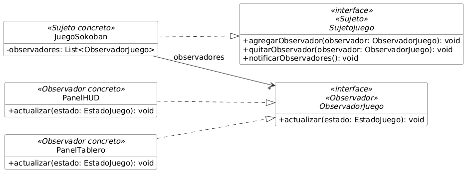

# Observer en el Sokoban

**Integrante:** Luca

## 1. Una frase

Cuando la partida cambia, el juego avisa a los paneles suscriptos (HUD y tablero) y cada uno se redibuja. El juego no sabe qué paneles hay: solo tiene una lista de `ObservadorJuego`.

## 2. Diagrama



Son las cuatro piezas de la materia y nada más. `EstadoJuego` es solo el tipo del dato que viaja en el aviso: una foto de la partida (movimientos, empujes, tablero…).

## 3. Igual que en la materia

| En la materia | En el Sokoban |
|---|---|
| Sujeto (interfaz con suscribir, desuscribir y notificar) | `SujetoJuego` |
| Sujeto concreto (tiene la lista de suscriptores) | `JuegoSokoban` |
| Observador (interfaz con actualizar) | `ObservadorJuego` |
| Observadores concretos | `PanelHUD` y `PanelTablero` |

## 4. El código

**El sujeto** (`JuegoSokoban.java`). La lista está en la línea 20 y los tres métodos en las líneas 133 a 148:

```java
private final List<ObservadorJuego> observadores = new ArrayList<>();

public void agregarObservador(ObservadorJuego observador) {
    observadores.add(observador);
}

public void quitarObservador(ObservadorJuego observador) {
    observadores.remove(observador);
}

public void notificarObservadores() {
    EstadoJuego estado = getEstado();
    for (ObservadorJuego observador : observadores) {
        observador.actualizar(estado);
    }
}
```

`notificarObservadores()` se llama al final de cada acción que cambia algo: `iniciarNivel`, `reiniciar`, `mover`, `deshacer` y `viajarEnElTiempo`.

**Los observadores.** Cada uno hace lo suyo con la foto que recibe. `PanelHUD.java`, líneas 58 a 64:

```java
public void actualizar(EstadoJuego estado) {
    movimientos.setIcon(crearIndicador("ui/indicador_movimientos", estado.movimientos()));
    // ... nivel, empujes, plutonio
}
```

`PanelTablero.java`, líneas 64 a 72:

```java
public void actualizar(EstadoJuego estado) {
    // ... gira al personaje hacia donde se movió
    tablero = estado.tablero();
    epoca = Epoca.delNivel(estado.nivel());
    repaint();
}
```

**La suscripción** está en `PantallaJuego.java`, líneas 60 y 61:

```java
juego.agregarObservador(hud);
juego.agregarObservador(tablero);
```

## 5. Por qué así

- Si `JuegoSokoban` llamara directo a `hud.actualizar()`, el dominio dependería de clases de Swing. Con el Observer, el dominio solo conoce la interfaz `ObservadorJuego`.
- El aviso lleva una foto (`EstadoJuego`) y no el tablero real, así la vista no puede cambiar nada del juego. Es la variante «push» del patrón: el sujeto manda los datos en el aviso.

## 6. Un detalle para la defensa

`JuegoSokoban` declara las dos interfaces: `implements Juego, SujetoJuego` (línea 16). Además la interfaz `Juego` (la fachada) hereda de `SujetoJuego`, y eso permite que la vista, que solo conoce `Juego`, pueda suscribirse.

## 7. Cómo comprobarlo

- **La prueba:** `ReglasTest.unObservadorQuitadoNoRecibeMasAvisos` (línea 167). Suscribe un observador, mueve, lo quita y vuelve a mover: recibe un solo aviso.
- **En el juego:** si comentás `juego.agregarObservador(hud);`, el HUD deja de cambiar pero el tablero sigue andando.
