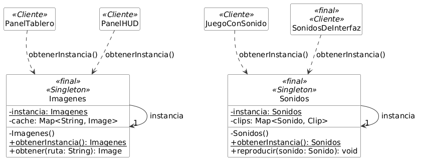

# Singleton en el Sokoban

**Integrantes:** Luca (`Imagenes`) y Mora (`Sonidos`)

## 1. Una frase

Las imágenes y los sonidos se leen del disco **una sola vez** y los comparte todo el juego. Para eso hay una única caché de imágenes (`Imagenes`) y un único reproductor de sonidos (`Sonidos`), y cualquiera llega a ellos con `obtenerInstancia()`.

## 2. Diagrama



Fuente: `3-singleton.puml`. Lo subrayado es `static`.

## 3. Igual que en la materia

| Rol clásico | `Imagenes` (Luca) | `Sonidos` (Mora) |
|---|---|---|
| Atributo estático con la única instancia | `private static Imagenes instancia` | `private static Sonidos instancia` |
| Constructor privado | `private Imagenes()` | `private Sonidos()` (carga los `.wav`) |
| Método estático de acceso | `obtenerInstancia()` | `obtenerInstancia()` |
| Clase que no se puede heredar | `public final class Imagenes` | `public final class Sonidos` |
| Clientes | `PanelTablero`, `PanelHUD`, `PanelAyuda`, `MenuPrincipal` | `JuegoConSonido`, `SonidosDeInterfaz` |
| Archivo | `vista/Imagenes.java` | `sonido/Sonidos.java` |

Los dos son de **inicialización perezosa** (*lazy*): la instancia se crea la primera vez que alguien la pide.

## 4. El código, en el orden en que pasa

**a) Imagenes.** `Imagenes.java`, líneas 17 a 38:

```java
public final class Imagenes {
    // ...
    private static Imagenes instancia;

    private final Map<String, Image> cache = new HashMap<>();

    private Imagenes() {
    }

    public static Imagenes obtenerInstancia() {
        if (instancia == null) {
            instancia = new Imagenes();
        }
        return instancia;
    }

    /** Ruta relativa a assets y sin extensión, por ejemplo "ui/boton_undo". */
    public Image obtener(String ruta) {
        return cache.computeIfAbsent(ruta, this::cargar);
    }
```

`computeIfAbsent` lee el archivo solo si todavía no está en la caché.

**b) Un cliente de Imagenes.** `PanelTablero.java`, línea 102 (se ejecuta por cada capa de cada casilla, en cada repintado):

```java
g.drawImage(Imagenes.obtenerInstancia().obtener(rutaDe(capa)), x, y, tamano, tamano, null);
```

**c) Sonidos.** `Sonidos.java`, líneas 24 a 47:

```java
public final class Sonidos {

    private static Sonidos instancia;

    private final Map<Sonido, Clip> clips = new EnumMap<>(Sonido.class);
    private EstadoSonido estado = new SonidoActivado();

    private Sonidos() {
        try {
            for (Sonido sonido : Sonido.values()) {
                cargar(sonido);
            }
        } catch (LineUnavailableException | IllegalArgumentException | SecurityException e) {
            // ... si la PC no tiene audio, sigue en silencio
        }
    }

    public static Sonidos obtenerInstancia() {
        if (instancia == null) {
            instancia = new Sonidos();
        }
        return instancia;
    }
```

**d) Un cliente de Sonidos.** `JuegoConSonido.java`, línea 60:

```java
Sonidos.obtenerInstancia().reproducir(sonido);
```

## 5. Qué pasa cuando arranca el juego

1. `Main` crea la ventana (`Main.java`, línea 26). Al armar el HUD, `PanelHUD.crearBoton` pide `Imagenes.obtenerInstancia()` (línea 86). `instancia` es `null`, así que se crea con la caché vacía.
2. Cada imagen se lee del disco la primera vez que alguien la pide; las siguientes salen de la caché, aunque las pida otra clase (`PanelTablero`, `MenuPrincipal`...).
3. `Main` llama a `SonidosDeInterfaz.instalar()` (línea 27), que pide `Sonidos.obtenerInstancia()` (`SonidosDeInterfaz.java`, línea 28). Se crea la instancia: el constructor carga los 16 `.wav` una sola vez.
4. Suena el arranque. Desde ahí, cada `Sonidos.obtenerInstancia()` (por ejemplo el de `JuegoConSonido` en cada paso) devuelve el mismo objeto.

## 6. Por qué así y no de otra forma

| Alternativa | Por qué no |
|---|---|
| Que cada panel haga `ImageIO.read(...)` | El tablero se repinta en cada movimiento: leería los PNG del disco decenas de veces por segundo. |
| Que cada clase cree su propio `new Imagenes()` | Cada una tendría su caché: la misma imagen cargada varias veces. El constructor privado lo impide. |
| Una clase con todo `static` (sin instancia) | Funciona, pero no es un objeto: no se puede pasar como parámetro ni tener estado propio limpio. En `Sonidos` el estado del State (`estado`) vive en la instancia. |
| Crear la instancia en `Main` y pasarla a todos (inyección) | Es lo más limpio para pruebas, pero `Imagenes` se usa en métodos `static` de varios paneles: habría que pasarla por muchos constructores. |

## 7. Code smells

| Smell | Dónde | ¿Justificado? Arreglo |
|---|---|---|
| **Dependencia oculta (estado global).** Las clases llaman `obtenerInstancia()` adentro de sus métodos, así que por la firma no se ve que usan imágenes o sonido. | `PanelHUD` líneas 70 y 86, `PanelTablero` 83 y 102, `JuegoConSonido` 60 y 68, `SonidosDeInterfaz` 28, 37 y 44 | **A medias.** Es el costo típico del Singleton. Consecuencia concreta: `JuegoConSonido` no tiene prueba porque no se puede reemplazar `Sonidos` por uno falso. Arreglo: pasarle `Sonidos` por constructor a `JuegoConSonido`. |
| **No es seguro con varios hilos**: el `if (instancia == null)` no está sincronizado. | `Imagenes.java` línea 29, `Sonidos.java` línea 43 | **Sí.** Todo corre en el hilo de Swing: `Main` usa `SwingUtilities.invokeLater` y los `Timer` de Swing también corren ahí. Si hiciera falta: `synchronized` o el *holder idiom*. |
| **`Sonidos` hace muchas cosas**: es Singleton, es el contexto del State, carga los `.wav` y los reproduce (SRP). | `Sonidos.java` | **A medias.** Son 96 líneas. La carga podría ir a una clase `CargadorDeSonidos`. |
| `Imagenes` además dibuja fondos (`dibujarFondo`) | `Imagenes.java`, líneas 41 a 47 | **Sí.** Es un ayudante chico que usan el tablero y el menú. |
| Si falta una imagen, `Imagenes` corta el juego con una excepción; si falta un sonido, `Sonidos` sigue en silencio | `Imagenes.java` línea 64, `Sonidos.java` líneas 76 a 79 | **Sí.** Sin imágenes no se puede jugar; sin sonido sí. |

## 8. Lista de chequeo

- [x] Constructor privado: `private Imagenes()` (línea 25) y `private Sonidos()` (línea 31).
- [x] Atributo estático privado con la única instancia: `instancia` (líneas 21 y 26).
- [x] Método estático público que la devuelve y la crea si hace falta: `obtenerInstancia()` (líneas 28 y 42).
- [x] La clase no se puede heredar: `final`.
- [x] Nadie hace `new Imagenes()` ni `new Sonidos()` fuera de su clase (no compila).

## 9. Cómo comprobarlo vos

- **Pruebas:** no hay prueba automática de estos dos Singleton (las 24 pruebas son del modelo y no cargan imágenes ni sonidos).
- **Experimento:** agregá `System.out.println("Cargo " + ruta);` al principio de `Imagenes.cargar` (línea 50). Al jugar, cada imagen se imprime **una sola vez** aunque el tablero se repinte en cada paso.
- **Experimento 2:** en `PanelHUD`, intentá escribir `new Imagenes()`. El compilador no te deja porque el constructor es privado.
