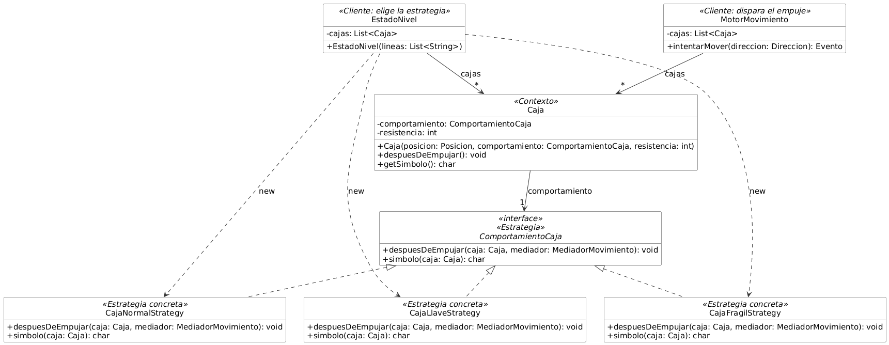

# Strategy en el Sokoban

**Integrantes:** Pedro y Lucía

## 1. Una frase

Hay tres tipos de caja (normal, frágil y llave) que se empujan igual pero hacen algo distinto **después** del empuje. La `Caja` no tiene un `if` por tipo: le delega esa parte a su estrategia, `ComportamientoCaja`.

## 2. Diagrama



Fuente: `4-strategy.puml`. El `MediadorMovimiento` aparece solo como tipo de parámetro: es el de la ficha 5.

## 3. Igual que en la materia

| Rol clásico | En el Sokoban | Archivo |
|---|---|---|
| Contexto (tiene una estrategia y le delega) | `Caja`, atributo `comportamiento` | `modelo/entidades/Caja.java` |
| Estrategia (interfaz) | `ComportamientoCaja` | `modelo/estrategias/ComportamientoCaja.java` |
| Estrategias concretas | `CajaNormalStrategy`, `CajaFragilStrategy`, `CajaLlaveStrategy` | `modelo/estrategias/` |
| Cliente que elige la estrategia | `EstadoNivel` (crea las cajas y las guarda en `cajas`), al leer el archivo del nivel | `modelo/EstadoNivel.java` |
| Cliente que usa el contexto | `MotorMovimiento` (tiene la lista `cajas`), al empujar | `modelo/movimiento/MotorMovimiento.java` |

**Lo que falta respecto del diagrama de la materia:** no hay `setEstrategia(...)`. La estrategia se recibe en el constructor y el atributo es `final`. Ver la sección 7.

## 4. El código, en el orden en que pasa

**a) El cliente elige la estrategia al leer el nivel.** `EstadoNivel.java`, líneas 58 a 69:

```java
case '$', '*' -> {
    cajas.add(new Caja(posicion, new CajaNormalStrategy(), 0));
    // ...
}
case 'F' -> {
    cajas.add(new Caja(posicion, new CajaFragilStrategy(), RESISTENCIA_FRAGIL));
    // ...
}
case 'L' -> {
    cajas.add(new Caja(posicion, new CajaLlaveStrategy(), 0));
    yield ' ';
}
```

**b) La interfaz.** `ComportamientoCaja.java`, líneas 7 a 12:

```java
public interface ComportamientoCaja {
    void despuesDeEmpujar(Caja caja, MediadorMovimiento mediador);
    char simbolo(Caja caja);
}
```

**c) El contexto guarda la estrategia y le delega.** `Caja.java`, líneas 12 a 35:

```java
private final ComportamientoCaja comportamiento;
private int resistencia;

public Caja(Posicion posicion, ComportamientoCaja comportamiento, int resistencia) {
    super(posicion);
    this.comportamiento = comportamiento;
    this.resistencia = resistencia;
}

public void despuesDeEmpujar() {
    comportamiento.despuesDeEmpujar(this, mediador);
}
// ...
public char getSimbolo() {
    return comportamiento.simbolo(this);
}
```

**d) Las tres estrategias concretas.**

`CajaNormalStrategy.java`, líneas 10 a 11 (no hace nada):

```java
public void despuesDeEmpujar(Caja caja, MediadorMovimiento mediador) {
}
```

`CajaFragilStrategy.java`, líneas 10 a 17:

```java
public void despuesDeEmpujar(Caja caja, MediadorMovimiento mediador) {
    caja.quitarResistencia();
    if (caja.getResistencia() > 0) {
        mediador.cajaDanada(caja);
    } else {
        mediador.cajaRota(caja);
    }
}
```

`CajaLlaveStrategy.java`, líneas 10 a 12:

```java
public void despuesDeEmpujar(Caja caja, MediadorMovimiento mediador) {
    mediador.llaveEmpujada(caja);
}
```

**e) Quién usa el contexto.** `MotorMovimiento.java`, líneas 45 a 46. No pregunta de qué tipo es la caja:

```java
caja.setPosicion(deslizar(destino, direccion));
caja.despuesDeEmpujar();
```

## 5. Qué pasa cuando empujás una caja frágil por tercera vez

1. `MotorMovimiento.intentarMover` encuentra una caja adelante (en su lista `cajas`) y lugar libre detrás.
2. Mueve la caja y llama `caja.despuesDeEmpujar()` (línea 46).
3. `Caja` delega: `comportamiento.despuesDeEmpujar(this, mediador)`. El comportamiento es un `CajaFragilStrategy`.
4. La estrategia baja la resistencia de 1 a 0 y llama `mediador.cajaRota(caja)`.
5. El mediador saca la caja del nivel y marca el evento `CAJA_ROTA`.

Con una caja normal, el paso 4 no hace nada. Con una llave, el paso 4 es `mediador.llaveEmpujada(caja)`, que abre los muros si la caja quedó en el cerrojo.

## 6. Por qué así y no de otra forma

| Alternativa | Por qué no |
|---|---|
| Un `switch (tipo)` adentro de `Caja` o del mediador | Cada caja nueva obliga a abrir y editar ese `switch` (rompe OCP). Además `Caja` tendría las reglas de los tres tipos mezcladas (SRP). |
| Herencia: `CajaFragil extends Caja`, `CajaLlave extends Caja` | También funcionaría, pero ata el tipo a la clase. Con Strategy, `Caja.copiar()` (que usa el Memento) es una sola línea para los tres tipos y comparte la estrategia. Composición antes que herencia. |
| Que la estrategia cambie el tablero ella misma | Tendría que conocer `EstadoNivel`. Así solo avisa al mediador y él decide (ficha 5). |

## 7. Code smells

| Smell | Dónde | ¿Justificado? Arreglo |
|---|---|---|
| **Falta `setEstrategia`.** En el diagrama clásico el contexto puede cambiar de estrategia en ejecución. | `Caja.java`, línea 12 (`final`) | **Sí.** Una caja no cambia de tipo durante la partida: una frágil sigue siendo frágil aunque esté dañada (eso es la `resistencia`, no otra estrategia). GoF acepta que el cliente pase la estrategia al crear el contexto. Agregar un setter que nadie usa sería generalidad especulativa. |
| **Crear las estrategias no está abierto a extensión.** Para una caja nueva hay que tocar el `switch` de `EstadoNivel`, el `sobreDestino` de `EstadoNivel`, el mapa `CAPAS` de `PanelTablero` y quizás `MediadorMovimiento`. | `EstadoNivel.java` líneas 58 a 69 y 261 a 269 | **A medias.** El comportamiento sí está abierto (una clase nueva), la creación no. Arreglo: un `Map<Character, Supplier<ComportamientoCaja>>` o una fábrica. |
| **`resistencia` vive en `Caja` pero solo la usa la frágil** («campo temporal»). La normal y la llave reciben `0`. | `Caja.java`, línea 13 | **Sí.** Así las estrategias no tienen estado y `Caja.copiar()` (línea 38) puede compartirlas al guardar recuerdos del Memento. Si la resistencia estuviera en la estrategia, habría que copiar también la estrategia. |
| **La estrategia decide una letra para la vista** (`simbolo`) | `ComportamientoCaja.java`, línea 11 | **A medias.** Mezcla dominio con dibujo, pero así la vista no conoce el tipo de caja (solo recibe letras). |
| **La estrategia depende del mediador** (lo recibe por parámetro) | `ComportamientoCaja.java`, línea 9 | **Sí.** Es lo que une Strategy con Mediator: la estrategia avisa y el mediador cambia el tablero. |
| Se crea un objeto estrategia por cada caja aunque no tengan estado | `EstadoNivel.java`, líneas 59, 63 y 67 | **Sí.** Son pocas cajas. Podrían ser constantes compartidas. |
| Nombres mitad en inglés (`CajaNormalStrategy`) | `modelo/estrategias/` | Detalle. Ayuda a reconocer el rol, pero el resto del código está en castellano. |

## 8. Lista de chequeo

- [x] Hay una interfaz común a todas las variantes: `ComportamientoCaja`.
- [x] Una clase por variante: `CajaNormalStrategy`, `CajaFragilStrategy`, `CajaLlaveStrategy`.
- [x] El contexto tiene una referencia a la interfaz, no a una clase concreta: `Caja.comportamiento`.
- [x] El contexto delega y no pregunta el tipo: `Caja.despuesDeEmpujar()` y `getSimbolo()`.
- [x] El cliente elige la estrategia: `EstadoNivel` según la letra del archivo.
- [ ] El contexto permite cambiar la estrategia en ejecución (`setEstrategia`): **no, a propósito** (ver sección 7).

## 9. Cómo comprobarlo vos

- **Pruebas** (`ReglasTest`): `laFragilAguantaDosEmpujesYAlTerceroSeRompe` (líneas 74 a 82), `laLlaveSobreElCerrojoAbreLosMuros` (84 a 89) y `unaCajaNormalSobreElCerrojoNoAbreNada` (91 a 96): la misma jugada con dos estrategias distintas da resultados distintos. En `EventosTest`, `cadaEmpujeDeLaFragilAvisaQueSeDanaYAlTerceroQueSeRompe` (27 a 34).
- **Experimento:** en `EstadoNivel`, línea 59, cambiá `new CajaNormalStrategy()` por `new CajaFragilStrategy()` y poné `RESISTENCIA_FRAGIL` en lugar del `0`. Todas las cajas normales pasan a romperse al tercer empuje sin tocar `Caja` ni el mediador.
