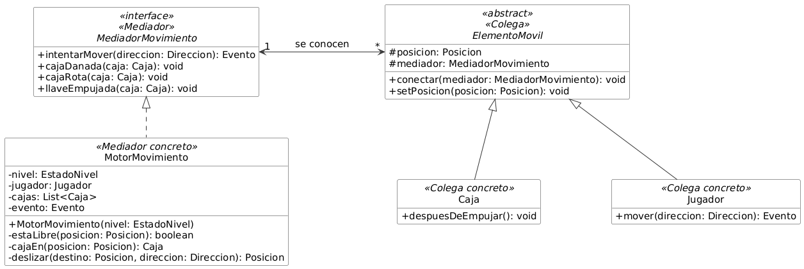

# Mediator en el Sokoban

**Integrantes:** Pedro y Lucía

## 1. Una frase

El jugador y las cajas no se hablan entre sí ni tocan el tablero. Cuando el jugador quiere moverse, o cuando una caja tiene algo que avisar (se dañó, se rompió, la llave llegó al cerrojo), se lo dicen al **mediador**, `MotorMovimiento`, que es el único que resuelve choques, empujes y hielo.

## 2. Diagrama



Fuente: `5-mediator.puml`.

**Una sola asociación bidireccional** `MediadorMovimiento "1" <--> "*" ElementoMovil`, como pide el profesor: el mediador y los elementos que se mueven se conocen, así que en vez de varias flechas va una con punta en los dos lados. Cada punta está respaldada por atributos reales. La punta del mediador (`1`) es el atributo `mediador` de `ElementoMovil`, que heredan `Jugador` y `Caja`. La punta de los elementos (`*`) son los atributos `jugador` y `cajas` de `MotorMovimiento`, que el motor recibe del nivel en su constructor: un jugador más todas las cajas.

## 3. Igual que en la materia

| Rol clásico | En el Sokoban | Archivo |
|---|---|---|
| Mediador (interfaz) | `MediadorMovimiento` | `modelo/movimiento/MediadorMovimiento.java` |
| Mediador concreto (conoce a los colegas) | `MotorMovimiento`, atributos `jugador` y `cajas` | `modelo/movimiento/MotorMovimiento.java` |
| Colega (abstracto, conoce al mediador) | `ElementoMovil`, atributo `mediador` | `modelo/entidades/ElementoMovil.java` |
| Colegas concretos | `Jugador` y `Caja` | `modelo/entidades/` |
| Cliente (crea el mediador y lo conecta) | `JuegoSokoban.cargar` y `EstadoNivel.conectarMediador` | `modelo/` |

## 4. El código, en el orden en que pasa

**a) Crear el mediador y conectarlo con el jugador y las cajas.** `JuegoSokoban.java`, línea 158, y `EstadoNivel.java`, líneas 90 a 96:

```java
nivel.conectarMediador(new MotorMovimiento(nivel));
```

```java
public void conectarMediador(MediadorMovimiento mediador) {
    this.mediador = mediador;
    jugador.conectar(mediador);
    for (Caja caja : cajas) {
        caja.conectar(mediador);
    }
}
```

**b) El mediador guarda al jugador y a las cajas.** `MotorMovimiento.java`, líneas 18 a 27. `getCajas()` devuelve una vista de solo lectura de la lista del nivel (`EstadoNivel.java`, líneas 105 a 107):

```java
private final EstadoNivel nivel;
private final Jugador jugador;
private final List<Caja> cajas;
private Evento evento;

public MotorMovimiento(EstadoNivel nivel) {
    this.nivel = nivel;
    this.jugador = nivel.getJugador();
    this.cajas = nivel.getCajas();
}
```

**c) `ElementoMovil` conoce solo la interfaz del mediador.** `ElementoMovil.java`, líneas 11 a 22:

```java
public abstract class ElementoMovil {

    protected Posicion posicion;
    protected MediadorMovimiento mediador;

    protected ElementoMovil(Posicion posicion) {
        this.posicion = posicion;
    }

    public void conectar(MediadorMovimiento mediador) {
        this.mediador = mediador;
    }
```

**d) La interfaz del mediador: un pedido del jugador y tres avisos de las cajas.** `MediadorMovimiento.java`, líneas 8 a 17:

```java
public interface MediadorMovimiento {
    Evento intentarMover(Direccion direccion);
    void cajaDanada(Caja caja);
    void cajaRota(Caja caja);
    void llaveEmpujada(Caja caja);
}
```

**e) El jugador no se mueve solo: le pide al mediador.** `Jugador.java`, líneas 14 a 16:

```java
public Evento mover(Direccion direccion) {
    return mediador.intentarMover(direccion);
}
```

**f) El mediador decide.** `MotorMovimiento.java`, líneas 30 a 55. `caja.setPosicion(...)` y `jugador.setPosicion(...)` mueven a la caja y al jugador, y `caja.despuesDeEmpujar()` le da a la caja la oportunidad de avisar algo:

```java
public Evento intentarMover(Direccion direccion) {
    Posicion siguiente = jugador.getPosicion().siguiente(direccion);
    Caja caja = cajaEn(siguiente);

    if (caja == null) {
        if (!estaLibre(siguiente)) {
            return Evento.CHOQUE;
        }
        evento = Evento.PASO;
    } else {
        Posicion destino = siguiente.siguiente(direccion);
        if (!estaLibre(destino)) {
            return Evento.CHOQUE;
        }
        evento = Evento.EMPUJE;
        caja.setPosicion(deslizar(destino, direccion));
        caja.despuesDeEmpujar();
    }

    jugador.setPosicion(siguiente);
    nivel.contarMovimiento(caja != null);
    if (nivel.recogerPlutonio(siguiente) && (evento == Evento.PASO || evento == Evento.EMPUJE)) {
        evento = Evento.PLUTONIO;
    }
    return evento;
}
```

**g) Quién ocupa cada casilla lo resuelve el mediador; al nivel solo le pregunta por el terreno.** `MotorMovimiento.java`, líneas 58 a 70:

```java
private boolean estaLibre(Posicion posicion) {
    return nivel.esTransitable(posicion) && cajaEn(posicion) == null
            && !jugador.getPosicion().equals(posicion);
}

private Caja cajaEn(Posicion posicion) {
    for (Caja caja : cajas) {
        if (caja.getPosicion().equals(posicion)) {
            return caja;
        }
    }
    return null;
}
```

**h) Los avisos de las cajas vuelven al mediador.** La caja llega por su estrategia (ficha 4). `MotorMovimiento.java`, líneas 81 a 97:

```java
public void cajaDanada(Caja caja) {
    evento = Evento.CAJA_DANADA;
}

@Override
public void cajaRota(Caja caja) {
    nivel.quitarCaja(caja);
    evento = Evento.CAJA_ROTA;
}

@Override
public void llaveEmpujada(Caja caja) {
    if (nivel.esCerrojo(caja.getPosicion())) {
        nivel.abrirMuros();
        evento = Evento.CERROJO_ABIERTO;
    }
}
```

## 5. Qué pasa cuando empujás la caja llave hasta el cerrojo

1. `JuegoSokoban.mover` llama `nivel.moverJugador(DERECHA)` (línea 69), y `EstadoNivel` se lo pasa a su jugador (`EstadoNivel.java`, líneas 110 a 112).
2. `Jugador.mover` le pide al mediador: `mediador.intentarMover(DERECHA)`.
3. `MotorMovimiento` busca en su lista `cajas` con `cajaEn` y encuentra la llave adelante. Con `estaLibre` comprueba que detrás no hay pared (le pregunta `esTransitable` al nivel), ni otra caja, ni el jugador: evento `EMPUJE`, mueve la caja y llama `caja.despuesDeEmpujar()`.
4. La caja delega en `CajaLlaveStrategy`, que avisa `mediador.llaveEmpujada(caja)`.
5. El mediador ve que la caja quedó sobre el cerrojo: `nivel.abrirMuros()` y evento `CERROJO_ABIERTO`.
6. De vuelta en `intentarMover`, mueve al jugador, cuenta el movimiento y devuelve `CERROJO_ABIERTO`.

La caja nunca habló con el jugador ni con el terreno.

## 6. Por qué así y no de otra forma

| Alternativa | Por qué no |
|---|---|
| Que `Jugador.mover` busque la caja y la empuje él | El jugador conocería a la caja y al tablero; la caja frágil y la llave tendrían que conocer al jugador para saber quién la empujó. Con N tipos de objeto se arma una red de N×N dependencias. |
| Que cada `Caja` cambie el tablero (abrir muros, sacarse del nivel) | La caja conocería `EstadoNivel` y las reglas quedarían repartidas en varias clases (baja cohesión). |
| Que todo esté en `JuegoSokoban.mover` | La fachada crecería con todas las reglas de movimiento. Así queda en una clase con una sola responsabilidad. |
| Que el nivel responda quién está en cada casilla (`cajaEn`, `estaLibre` en `EstadoNivel`) | El nivel haría de mediador a medias. Ahora `EstadoNivel` solo responde por el terreno (`esTransitable`, `esHielo`, `esCerrojo`) y el motor, que conoce al jugador y a las cajas, decide si la casilla está ocupada. |

## 7. Code smells

| Smell | Dónde | ¿Justificado? Arreglo |
|---|---|---|
| **Un método del mediador por tipo de caja** (`cajaDanada`, `cajaRota`, `llaveEmpujada`). Una caja nueva con un efecto nuevo agrega un método a la interfaz y a `MotorMovimiento` (OCP). | `MediadorMovimiento.java`, líneas 12 a 16 | **A medias.** Es lo esperable en un Mediator: centraliza el conocimiento. Se podría juntar en `cajaAviso(Caja, TipoAviso)`, pero se pierde claridad. |
| **`evento` como canal lateral.** Los avisos de la caja escriben el atributo `evento` mientras `intentarMover` está en curso, y después `intentarMover` lo devuelve. Depende del orden de las llamadas (acoplamiento temporal). | `MotorMovimiento.java`, línea 21 | **A medias.** Funciona porque todo pasa en la misma llamada. Arreglo: que los avisos devuelvan el `Evento` en vez de guardarlo. |
| **`setPosicion` es público**: cualquiera puede mover a un `ElementoMovil` sin pasar por el mediador. `EstadoNivel.restaurar` lo hace (línea 213). | `ElementoMovil.java`, línea 28 | **A medias.** El Memento necesita reubicar al jugador. Arreglo: visibilidad de paquete (habría que mover `EstadoNivel` o `ElementoMovil` de paquete). |
| **Dos clases tienen al jugador y a las cajas**: `EstadoNivel` (las crea, las copia para el Memento y las dibuja) y `MotorMovimiento` (las coordina). | `MotorMovimiento.java`, líneas 25 y 26; `EstadoNivel.java`, líneas 105 a 107 | **Sí.** El motor no guarda una copia sino una vista de solo lectura de la misma lista. Cuando una caja se rompe (`nivel.quitarCaja`) o se restaura el nivel (`cajas.clear()` y `addAll`), el motor ve el cambio sin actualizar nada. Depende de que `EstadoNivel` nunca reemplace la lista (el atributo es `final`). |
| **`Jugador` es un intermediario vacío**: solo reenvía al mediador. | `Jugador.java`, líneas 14 a 16 | **Sí.** Es exactamente el rol de colega: pedir, no resolver. |
| **Hay que volver a conectar el mediador** después de restaurar, porque las copias de las cajas no lo traen. Si alguien lo olvida, `NullPointerException`. | `EstadoNivel.java`, líneas 219 a 221 | **Sí**, está resuelto adentro de `restaurar`. |
| **Ciclos entre paquetes**: `EstadoNivel` importa `MediadorMovimiento` y `MotorMovimiento` importa `EstadoNivel`; `ElementoMovil` importa `MediadorMovimiento` y `MediadorMovimiento` importa `Caja`; `Caja` importa `ComportamientoCaja` y las estrategias importan `Caja`. | `modelo` y `modelo.movimiento`; `entidades` y `movimiento`; `entidades` y `estrategias` | **A medias.** Java lo compila sin problema y es esperable en un Mediator, donde el mediador y sus colegas se conocen. Los paquetes no son módulos independientes. |

## 8. Lista de chequeo

- [x] Interfaz de mediador: `MediadorMovimiento`.
- [x] Mediador concreto que conoce y coordina a los colegas: `MotorMovimiento`, con `jugador` y `cajas`.
- [x] Clase base de colega con referencia al mediador: `ElementoMovil.mediador`.
- [x] Colegas concretos que se comunican solo a través del mediador: `Jugador.mover` → `intentarMover`; `Caja` (por su estrategia) → `cajaDanada`, `cajaRota`, `llaveEmpujada`.
- [x] Los colegas no se conocen entre sí: `Jugador` no nombra a `Caja` y `Caja` no nombra a `Jugador`.
- [x] El colega conoce la interfaz, no el mediador concreto: el atributo `mediador` es de tipo `MediadorMovimiento`.

## 9. Cómo comprobarlo vos

- **Pruebas** (`ReglasTest`): `empujarMueveLaCajaEnLaMismaDireccion` (33 a 39), `noSePuedenEmpujarDosCajasALaVez` (41 a 46), `enElHieloLaCajaSeDeslizaHastaElPrimerPisoNormal` (57 a 63), `laLlaveSobreElCerrojoAbreLosMuros` (84 a 89). En `EventosTest`: `laLlaveSobreElCerrojoEsCerrojoAbiertoYUnaParedEsChoque` (18 a 25).
- **Experimento:** buscá `Caja` en `Jugador.java` y `Jugador` en `Caja.java`: no aparecen. Todo lo que se cruzan pasa por `MotorMovimiento`.
