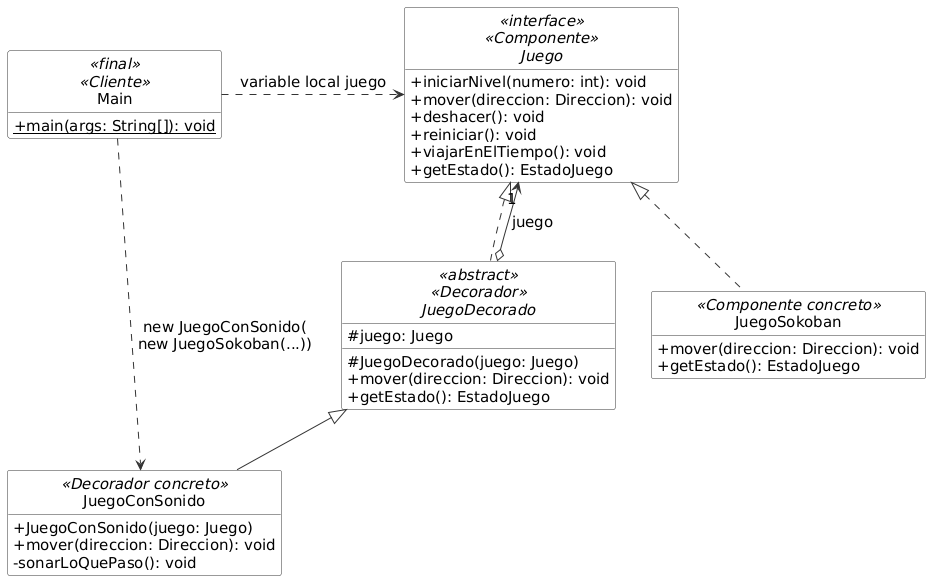

# Decorator en el Sokoban

**Integrante:** Mora

## 1. Una frase

Queremos que el juego suene (pasos, empujes, choques, victoria) **sin tocar** `JuegoSokoban`. `JuegoConSonido` envuelve al juego: recibe cada pedido, se lo pasa al juego de adentro y después hace sonar el efecto de lo que pasó.

## 2. Diagrama



Fuente: `6-decorator.puml`. En `JuegoSokoban` y `JuegoDecorado` se muestran solo `mover` y `getEstado` como ejemplo. `JuegoConSonido` no sobrescribe `getEstado`; además de `mover` sobrescribe `iniciarNivel`, `deshacer`, `reiniciar` y `viajarEnElTiempo`, que funcionan igual. La línea punteada de `Main` a `Juego` es la variable local `juego` de `main` (`Main` no tiene atributos).

## 3. Igual que en la materia

| Rol clásico | En el Sokoban | Archivo |
|---|---|---|
| Componente (interfaz) | `Juego` | `modelo/Juego.java` |
| Componente concreto | `JuegoSokoban` | `modelo/JuegoSokoban.java` |
| Decorador (abstracto, tiene un Componente y le reenvía todo) | `JuegoDecorado`, atributo `juego` | `modelo/JuegoDecorado.java` |
| Decorador concreto (agrega comportamiento) | `JuegoConSonido` | `sonido/JuegoConSonido.java` |
| Cliente (arma la cadena) | `Main` | `Main.java` |

Ayudantes del decorador concreto: el `enum Evento` (lo que pasó, lo calcula el dominio) y `Sonido.de(evento)` (qué efecto le corresponde).

## 4. El código, en el orden en que pasa

**a) El cliente arma la cadena.** `Main.java`, línea 25. El resto del programa solo ve un `Juego`:

```java
Juego juego = new JuegoConSonido(new JuegoSokoban(new CargadorNivel(carpeta)));
```

**b) El decorador base implementa `Juego`, tiene un `Juego` y le reenvía todo.** `JuegoDecorado.java`, líneas 10 a 31 (el resto de los métodos es igual):

```java
public abstract class JuegoDecorado implements Juego {

    protected final Juego juego;

    protected JuegoDecorado(Juego juego) {
        this.juego = Objects.requireNonNull(juego, "El juego decorado no puede ser null");
    }
    // ...
    @Override
    public void mover(Direccion direccion) {
        juego.mover(direccion);
    }
```

**c) El decorador concreto agrega el sonido después.** `JuegoConSonido.java`, líneas 32 a 36. Primero el juego real (`super.mover`) y después lo agregado (`sonarLoQuePaso`):

```java
@Override
public void mover(Direccion direccion) {
    super.mover(direccion);
    sonarLoQuePaso();
}
```

**d) Qué suena.** `JuegoConSonido.java`, líneas 56 a 65:

```java
private void sonarLoQuePaso() {
    EstadoJuego estado = juego.getEstado();
    Sonido sonido = Sonido.de(estado.evento());
    if (sonido != null) {
        Sonidos.obtenerInstancia().reproducir(sonido);
    }
    if (estado.evento() == Evento.CAJA_ROTA && estado.sinSolucion()) {
        sonarMasTarde(Sonido.DERROTA);
    }
}
```

**e) De evento a sonido.** `Sonido.java`, líneas 36 a 41 (sigue igual para los 14 eventos; `NINGUNO` da `null`):

```java
public static Sonido de(Evento evento) {
    return switch (evento) {
        case INICIO_NIVEL -> INICIO_NIVEL;
        case REINICIO -> REINICIAR;
        case PASO -> PASO;
        case CHOQUE -> CHOQUE;
```

## 5. Qué pasa cuando chocás contra una pared

1. `ComandoMover` llama `juego.mover(IZQUIERDA)`. `juego` es el `JuegoConSonido`.
2. `JuegoConSonido.mover` llama `super.mover(...)`, o sea `JuegoDecorado.mover`, que llama al `JuegoSokoban`.
3. `JuegoSokoban.mover` deja `evento = CHOQUE` y sale **sin avisar a los observadores** (líneas 69 a 71): el tablero no cambió.
4. De vuelta en `JuegoConSonido`, `sonarLoQuePaso()` pide `getEstado()`, ve `CHOQUE` y `Sonido.de` devuelve `Sonido.CHOQUE`.
5. `Sonidos` lo reproduce (si no está silenciado, ver ficha 7).

## 6. Por qué así y no de otra forma

| Alternativa | Por qué no |
|---|---|
| Poner las llamadas a `Sonidos` dentro de `JuegoSokoban` | El dominio dependería del audio (rompe SRP y DIP) y las pruebas del modelo cargarían archivos `.wav`. |
| Hacer el sonido un **observador** más | En un choque no hay aviso (paso 3), así que el choque no sonaría nunca. Tampoco suenan los deshacer o DeLorean que fallan. El decorador se entera de **cada** pedido, cambie algo o no. |
| Una subclase `JuegoSokobanConSonido extends JuegoSokoban` | Ata el sonido a esa clase concreta. Con Decorator se puede envolver cualquier `Juego` y apilar otros decoradores (por ejemplo, uno que registre estadísticas) sin cambiar nada (OCP). |
| Sin `JuegoDecorado`: que `JuegoConSonido` implemente `Juego` directo | Funciona, pero cada decorador nuevo repetiría los 10 reenvíos. La clase base es el "Decorador" del diagrama clásico. |

## 7. Code smells

| Smell | Dónde | ¿Justificado? Arreglo |
|---|---|---|
| **Dependencia oculta del Singleton**: el decorador llama `Sonidos.obtenerInstancia()` adentro. Por eso no hay prueba de `JuegoConSonido`. | `JuegoConSonido.java`, líneas 60 y 68 | **No del todo.** Arreglo: recibir `Sonidos` (o una interfaz `Reproductor`) en el constructor. |
| **El decorador también reenvía el Observer** (`agregarObservador`, `quitarObservador`, `notificarObservadores`), porque `Juego` hereda de `SujetoJuego`. Los observadores quedan suscriptos al juego de adentro. | `JuegoDecorado.java`, líneas 53 a 66 | **Sí.** Es lo correcto: el decorador no cambia los avisos. Si algún día un decorador quisiera filtrar avisos, no podría. |
| **Pide una foto completa solo para leer el evento**: `getEstado()` copia el tablero entero. | `JuegoConSonido.java`, línea 57 | **Sí.** El tablero es chico. |
| **El dominio tiene un `evento` pensado para el sonido** (lo dice el comentario de `Evento`). | `Evento.java`, línea 3; `JuegoSokoban.java`, línea 26 | **Sí.** Es un evento de dominio ("qué pasó"); el dominio no sabe que hay sonido. La traducción a efecto está en `Sonido.de`, del lado del sonido. |
| `JuegoDecorado` está en `modelo` y `JuegoConSonido` en `sonido` | | **Sí.** El decorador base no sabe de sonido; cualquier decorador futuro lo reutiliza. |

## 8. Lista de chequeo

- [x] Hay una interfaz de componente: `Juego`.
- [x] El componente concreto la implementa: `JuegoSokoban`.
- [x] El decorador implementa la misma interfaz **y** tiene un componente: `JuegoDecorado implements Juego` con `protected final Juego juego`.
- [x] El decorador base reenvía cada método al componente: los 10 métodos de `JuegoDecorado`.
- [x] El decorador concreto agrega algo antes o después de reenviar: `JuegoConSonido` hace `super.xxx()` y después `sonarLoQuePaso()`.
- [x] El cliente no se entera: `VentanaPrincipal` y `PantallaJuego` reciben un `Juego` y no saben si suena o no.
- [x] Se puede decorar en cadena: el constructor recibe cualquier `Juego`, incluso otro decorador.

## 9. Cómo comprobarlo vos

- **Pruebas:** no hay prueba automática del decorador (ver smell de la sección 7). Las pruebas del modelo usan `JuegoSokoban` sin decorar, y eso ya muestra que el juego anda igual sin el sonido.
- **Experimento:** en `Main.java`, línea 25, cambiá a `Juego juego = new JuegoSokoban(new CargadorNivel(carpeta));`. El juego funciona igual, pero sin efectos de sonido (el clic de los botones y la M siguen, porque son de `SonidosDeInterfaz`).
