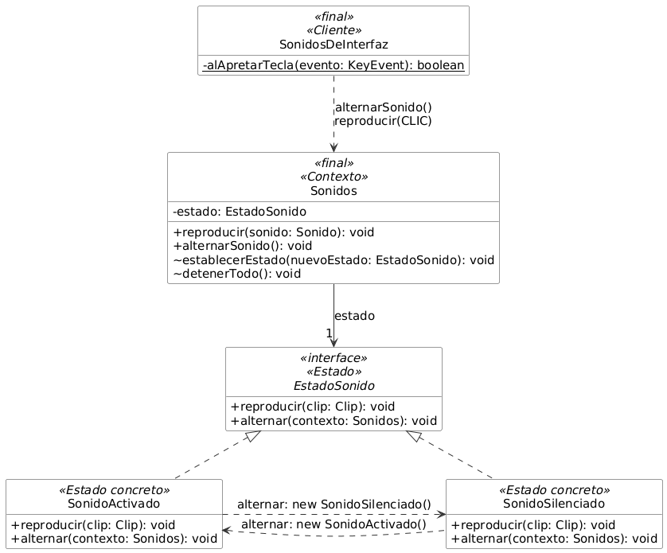

# State en el Sokoban

**Integrante:** Mora

## 1. Una frase

El sonido puede estar **activado** o **silenciado** (tecla M). En vez de un `if (silenciado)` en cada lugar que reproduce, `Sonidos` le delega a un objeto estado, y cada estado sabe qué hacer al reproducir y a qué estado pasar cuando se aprieta la M.

## 2. Diagrama



Fuente: `7-state.puml`. `~` es visibilidad de paquete: solo los estados (que están en el mismo paquete) pueden cambiar el estado del contexto.

## 3. Igual que en la materia

| Rol clásico | En el Sokoban | Archivo |
|---|---|---|
| Contexto (tiene el estado actual y le delega) | `Sonidos`, atributo `estado` | `sonido/Sonidos.java` |
| Estado (interfaz) | `EstadoSonido`: `reproducir(Clip)` y `alternar(Sonidos)` | `sonido/EstadoSonido.java` |
| Estados concretos | `SonidoActivado` (el inicial) y `SonidoSilenciado` | `sonido/` |
| Cliente | `SonidosDeInterfaz` (tecla M y clics); también `JuegoConSonido` pide reproducir | `sonido/` |

Las **transiciones las deciden los estados**: cada uno llama a `contexto.establecerEstado(...)` con el siguiente.

## 4. El código, en el orden en que pasa

**a) El contexto arranca activado y delega.** `Sonidos.java`, línea 29 y líneas 50 a 65:

```java
private EstadoSonido estado = new SonidoActivado();
```

```java
public void reproducir(Sonido sonido) {
    Clip clip = clips.get(sonido);
    if (clip != null) {                // null = la PC no tiene audio o falta el archivo
        estado.reproducir(clip);
    }
}

/** Tecla M: activa / desactiva el sonido. La transición la decide el estado actual. */
public void alternarSonido() {
    estado.alternar(this);
}

/** Lo usan los estados para hacer la transición. */
void establecerEstado(EstadoSonido nuevoEstado) {
    this.estado = nuevoEstado;
}
```

**b) La interfaz del estado.** `EstadoSonido.java`, líneas 11 a 18:

```java
interface EstadoSonido {
    void reproducir(Clip clip);
    void alternar(Sonidos contexto);
}
```

**c) Activado: suena y, con la M, pasa a silenciado.** `SonidoActivado.java`, líneas 14 a 25:

```java
public void reproducir(Clip clip) {
    clip.stop();
    clip.setFramePosition(0);
    clip.start();
}

/** Al silenciar, corta lo que esté sonando y pasa a Silenciado. */
@Override
public void alternar(Sonidos contexto) {
    contexto.detenerTodo();
    contexto.establecerEstado(new SonidoSilenciado());
}
```

**d) Silenciado: no hace nada y, con la M, vuelve a activado.** `SonidoSilenciado.java`, líneas 14 a 22:

```java
public void reproducir(Clip clip) {
    // intencionalmente vacío
}

/** Al volver a apretar M, pasa a Activado. */
@Override
public void alternar(Sonidos contexto) {
    contexto.establecerEstado(new SonidoActivado());
}
```

**e) El cliente: la tecla M, escuchada para toda la aplicación.** `SonidosDeInterfaz.java`, líneas 42 a 47:

```java
private static boolean alApretarTecla(KeyEvent evento) {
    if (evento.getID() == KeyEvent.KEY_PRESSED && evento.getKeyCode() == KeyEvent.VK_M) {
        Sonidos.obtenerInstancia().alternarSonido();
    }
    return false;
}
```

## 5. Qué pasa cuando apretás M y después te movés

1. `alApretarTecla` ve la M y llama `Sonidos.alternarSonido()`.
2. El estado actual es `SonidoActivado`: `alternar` corta lo que suena (`detenerTodo`) y pone un `SonidoSilenciado` en el contexto.
3. Movés: `JuegoConSonido` llama `Sonidos.reproducir(Sonido.PASO)`.
4. `Sonidos` busca el clip y llama `estado.reproducir(clip)`. Ahora el estado es `SonidoSilenciado`: no hace nada.
5. Apretás M otra vez: `SonidoSilenciado.alternar` pone un `SonidoActivado` y vuelve a sonar.

Ni `JuegoConSonido` ni `Sonidos` tienen un `if (silenciado)`.

## 6. Por qué así y no de otra forma

| Alternativa | Por qué no |
|---|---|
| Un `boolean silenciado` y un `if` en `reproducir` y en `alternarSonido` | Con dos estados es más corto y sería válido. Pero cada estado nuevo (por ejemplo "solo música" o "volumen bajo") agregaría `if` en cada método (rompe OCP). Con State se agrega una clase. |
| Que la transición la decida `Sonidos` (`if (estado instanceof SonidoActivado) ...`) | El contexto tendría que conocer todos los estados concretos. Así cada estado sabe cuál le sigue. |
| Strategy en vez de State | La estructura es la misma, pero en Strategy el cliente elige y la estrategia no cambia sola. Acá el objeto **cambia de estado él mismo** con la M: eso es State. |

## 7. Code smells

| Smell | Dónde | ¿Justificado? Arreglo |
|---|---|---|
| **Patrón quizás grande para dos estados** («generalidad especulativa»). | `sonido/EstadoSonido.java` y sus dos clases | **A medias.** Un `boolean` alcanzaría hoy. Lo justifica que los dos métodos cambian de comportamiento según el estado y que es fácil sumar estados. |
| **Se crea un estado nuevo en cada M** aunque no tienen atributos. | `SonidoActivado.java` línea 24, `SonidoSilenciado.java` línea 21 | **Sí.** Es una tecla; no pesa. Podrían ser constantes compartidas. |
| **El contexto es además Singleton y cargador de archivos** (SRP). | `Sonidos.java` | **A medias.** Ver ficha 3. |
| **El estado silenciado no recuerda nada**: al reactivar, no vuelve lo que estaba sonando. | `SonidoSilenciado.java`, línea 21 | **Sí.** Son efectos cortos. |
| La M funciona en cualquier pantalla (menú, carteles) porque escucha a toda la aplicación | `SonidosDeInterfaz.java`, línea 27 | **Sí.** Es lo esperable para silenciar. |

## 8. Lista de chequeo

- [x] El contexto tiene una referencia al estado actual (de tipo interfaz): `Sonidos.estado`.
- [x] Interfaz de estado con las operaciones que cambian según el estado: `EstadoSonido.reproducir` y `alternar`.
- [x] Una clase por estado: `SonidoActivado`, `SonidoSilenciado`.
- [x] El contexto delega sin preguntar en qué estado está: `estado.reproducir(clip)` y `estado.alternar(this)`.
- [x] Los estados hacen la transición: llaman `contexto.establecerEstado(...)`.
- [x] Hay un estado inicial: `new SonidoActivado()` (línea 29).
- [x] Solo los estados pueden cambiar el estado: `establecerEstado` es de paquete.

## 9. Cómo comprobarlo vos

- **Pruebas:** no hay prueba automática del State (el sonido no está en las pruebas del modelo).
- **En el juego:** apretá M y movete: no suena nada. Apretá M otra vez: vuelve. Si apretás M mientras suena la victoria, se corta en el acto (`detenerTodo`).
