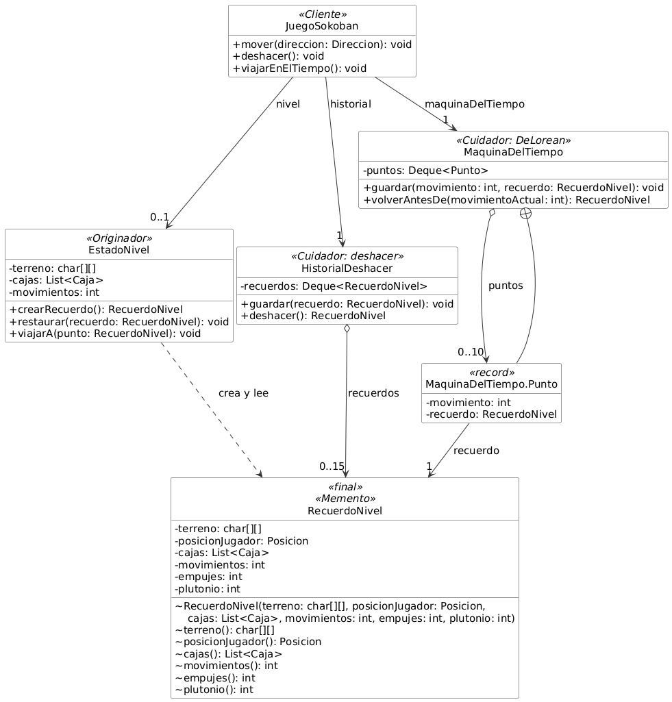

# Memento en el Sokoban

**Integrante:** Martín

## 1. Una frase

Para **deshacer** (5 pasos atrás, hasta 3 veces seguidas) y para el **DeLorean** (volver al último punto en el tiempo) hay que guardar fotos del nivel y volver a ellas, sin que nadie más que el propio nivel pueda leer o cambiar lo que hay adentro de la foto.

## 2. Diagrama



Fuente: `8-memento.puml`. `~` es visibilidad de paquete: el constructor y los métodos de `RecuerdoNivel` solo los ve el paquete `sokoban.modelo`, donde está `EstadoNivel`. Los cuidadores están en `sokoban.modelo.tiempo` y no los pueden usar. `MaquinaDelTiempo.Punto` es el `record` privado que está adentro de `MaquinaDelTiempo` (el círculo con la cruz marca la clase anidada): cada punto guarda un recuerdo junto con su número de movimiento.

## 3. Igual que en la materia

| Rol clásico | En el Sokoban | Archivo |
|---|---|---|
| Originador (crea el memento y se restaura desde él) | `EstadoNivel`: `crearRecuerdo()`, `restaurar(...)` y `viajarA(...)` | `modelo/EstadoNivel.java` |
| Memento (la foto, opaca para los demás) | `RecuerdoNivel` | `modelo/RecuerdoNivel.java` |
| Cuidador 1 (guarda sin mirar adentro) | `HistorialDeshacer`: últimos 15, vuelve 5, hasta 3 seguidas | `modelo/tiempo/HistorialDeshacer.java` |
| Cuidador 2 | `MaquinaDelTiempo`: hasta 10 puntos en el tiempo | `modelo/tiempo/MaquinaDelTiempo.java` |
| Cliente (decide cuándo guardar y cuándo volver) | `JuegoSokoban` | `modelo/JuegoSokoban.java` |

## 4. El código, en el orden en que pasa

**a) El originador saca la foto.** `EstadoNivel.java`, líneas 206 a 209. Copia el terreno y las cajas para que la foto no cambie después:

```java
public RecuerdoNivel crearRecuerdo() {
    return new RecuerdoNivel(copiar(terreno), jugador.getPosicion(), copiar(cajas),
            movimientos, empujes, plutonio);
}
```

**b) El memento: todo privado, y lo de leer es de paquete.** `RecuerdoNivel.java`, líneas 12 a 33:

```java
public final class RecuerdoNivel {

    private final char[][] terreno;
    private final Posicion posicionJugador;
    private final List<Caja> cajas;
    private final int movimientos;
    private final int empujes;
    private final int plutonio;

    RecuerdoNivel(char[][] terreno, Posicion posicionJugador, List<Caja> cajas,
                  int movimientos, int empujes, int plutonio) {
        // ... asigna los seis atributos
    }

    char[][] terreno() {
        return terreno;
    }
```

**c) Antes de cada movimiento, el cliente se lo da al cuidador del deshacer.** `JuegoSokoban.java`, líneas 67 a 75:

```java
RecuerdoNivel antes = nivel.crearRecuerdo();
int cajasEnDestinoAntes = nivel.cajasEnDestino();
evento = nivel.moverJugador(direccion);
if (evento == Evento.CHOQUE) {
    return;
}
historial.guardar(antes);
if (nivel.cajasEnDestino() > cajasEnDestinoAntes) {
    maquinaDelTiempo.guardar(nivel.getMovimientos(), nivel.crearRecuerdo());
```

La última línea es el otro cuidador: cada vez que una caja llega a un destino se guarda un punto en el tiempo.

**d) El cuidador del deshacer: guarda 15 y devuelve el de 5 atrás.** `HistorialDeshacer.java`, líneas 14 a 41:

```java
private static final int MAXIMO = 15;
private static final int PASOS_POR_USO = 5;
private static final int USOS_SEGUIDOS = 3;

private final Deque<RecuerdoNivel> recuerdos = new ArrayDeque<>();
private int usosSeguidos;

/** Se llama antes de cada movimiento; moverse vuelve a habilitar los 3 usos. */
public void guardar(RecuerdoNivel recuerdo) {
    recuerdos.push(recuerdo);
    if (recuerdos.size() > MAXIMO) {
        recuerdos.removeLast();
    }
    usosSeguidos = 0;
}

/** Devuelve el recuerdo de 5 movimientos atrás, o null si no se puede deshacer. */
public RecuerdoNivel deshacer() {
    if (recuerdos.isEmpty() || usosSeguidos >= USOS_SEGUIDOS) {
        return null;
    }
    RecuerdoNivel recuerdo = null;
    for (int i = 0; i < PASOS_POR_USO && !recuerdos.isEmpty(); i++) {
        recuerdo = recuerdos.pop();
    }
    usosSeguidos++;
    return recuerdo;
}
```

El cuidador nunca llama `recuerdo.terreno()` ni nada de adentro: no puede, porque está en otro paquete.

**e) El cuidador del DeLorean guarda cada punto con su número de movimiento.** `MaquinaDelTiempo.java`, líneas 17 a 27:

```java
private record Punto(int movimiento, RecuerdoNivel recuerdo) {
}

private final Deque<Punto> puntos = new ArrayDeque<>();

public void guardar(int movimiento, RecuerdoNivel recuerdo) {
    puntos.push(new Punto(movimiento, recuerdo));
    if (puntos.size() > MAXIMO_PUNTOS) {
        puntos.removeLast();
    }
}
```

**f) El originador se restaura.** `EstadoNivel.java`, líneas 211 a 222:

```java
public void restaurar(RecuerdoNivel recuerdo) {
    terreno = copiar(recuerdo.terreno());
    jugador.setPosicion(recuerdo.posicionJugador());
    cajas.clear();
    cajas.addAll(copiar(recuerdo.cajas()));
    movimientos = recuerdo.movimientos();
    empujes = recuerdo.empujes();
    plutonio = recuerdo.plutonio();
    if (mediador != null) {
        conectarMediador(mediador);
    }
}
```

`viajarA(punto)` (líneas 228 a 240) hace lo mismo pero respeta la regla del DeLorean: el plutonio ya juntado no reaparece y las cargas siguen iguales.

## 5. Qué pasa cuando hacés 20 pasos y apretás "Deshacer"

1. En cada paso, `JuegoSokoban.mover` saca una foto **antes** de moverse y, si el paso se hizo, la guarda en `HistorialDeshacer`. A partir del paso 16, la foto más vieja se descarta: quedan las de antes de los pasos 6 a 20.
2. Apretás Deshacer: `JuegoSokoban.deshacer` pide `historial.deshacer()`.
3. El cuidador saca 5 fotos de la pila y devuelve la última: la de antes del paso 16, o sea, con 15 movimientos.
4. `nivel.restaurar(recuerdo)` deja el nivel como estaba. `MaquinaDelTiempo.olvidarDespuesDe(15)` borra los puntos en el tiempo de un futuro que ya no existe.
5. Dos Deshacer más te dejan en 5 movimientos. Un cuarto seguido no hace nada (`usosSeguidos >= 3`). Si te movés, se habilita de nuevo.

## 6. Por qué así y no de otra forma

| Alternativa | Por qué no |
|---|---|
| Que los cuidadores guarden directamente `EstadoNivel` | Guardarían el mismo objeto que se sigue modificando: todas las "fotos" serían el presente. Y cualquiera podría cambiarlo. |
| Que `RecuerdoNivel` tenga getters públicos | Rompe el encapsulamiento del originador: cualquiera podría leer o armar un nivel a mano. Los métodos de paquete dan la "interfaz ancha" solo al originador. |
| Deshacer con Command (cada comando sabe deshacerse) | Habría que programar el "contrario" de cada efecto: romper una caja frágil, abrir muros, juntar plutonio, deslizar por el hielo. Con una foto se vuelve a todo de una vez (ver ficha 9). |
| Un solo cuidador para todo | Las dos reglas son distintas (15/5/3 contra puntos en el tiempo). Separadas, cada clase tiene una responsabilidad. |

## 7. Code smells

| Smell | Dónde | ¿Justificado? Arreglo |
|---|---|---|
| **El encapsulamiento es por paquete, no por clase**: cualquier clase de `sokoban.modelo` (`JuegoSokoban`, `Puntaje`, `CargadorNivel`) podría leer el recuerdo. | `RecuerdoNivel.java`, líneas 21 y 31 a 53 | **A medias.** Java no tiene `friend`. Hoy solo `EstadoNivel` lo lee. Arreglo más estricto: que `RecuerdoNivel` sea una clase anidada `static` de `EstadoNivel` con atributos privados. |
| **El memento guarda objetos mutables** (`char[][]`, `List<Caja>`). Está seguro solo porque el originador copia al crear (línea 207) y al restaurar (líneas 212 y 215). | `RecuerdoNivel.java`, líneas 14 y 16 | **Sí.** Se copia en los dos lados. Si alguien saca una de las copias, dos fotos compartirían cajas. |
| **Se saca una foto aunque el paso choque** y se tira. | `JuegoSokoban.java`, líneas 67 y 70 a 72 | **Sí.** No se sabe si va a chocar hasta intentarlo. El nivel es chico. |
| **El cliente coordina a los dos cuidadores** (`olvidarDespuesDe` al deshacer, `olvidarTodo` al viajar). | `JuegoSokoban.java`, líneas 94 y 111 | **Sí.** Es trabajo de fachada (ficha 1): ninguno de los dos cuidadores conoce al otro. |
| **Dos formas de restaurar** en el originador (`restaurar` y `viajarA`). | `EstadoNivel.java`, líneas 211 y 228 | **Sí.** El DeLorean tiene una regla propia (el plutonio) y le corresponde al originador, que es el que conoce el terreno. |
| **Hay que reconectar el mediador** al restaurar, porque las cajas copiadas no lo traen. | `EstadoNivel.java`, líneas 219 a 221 | **Sí**, ver ficha 5. |

## 8. Lista de chequeo

- [x] El originador crea el memento con su estado: `EstadoNivel.crearRecuerdo()`.
- [x] El originador se restaura desde el memento: `EstadoNivel.restaurar(RecuerdoNivel)`.
- [x] El memento guarda el estado y no lo deja cambiar: `RecuerdoNivel` es `final` con atributos `private final`.
- [x] Interfaz estrecha para el cuidador: fuera del paquete `sokoban.modelo` no se ve ni el constructor ni ningún método.
- [x] El cuidador guarda mementos sin mirarlos: `HistorialDeshacer` y `MaquinaDelTiempo` solo hacen `push`, `pop` y devuelven.
- [x] Alguien decide cuándo guardar y cuándo restaurar: `JuegoSokoban` (`mover`, `deshacer`, `viajarEnElTiempo`).

## 9. Cómo comprobarlo vos

- **Pruebas** (`ReglasTest`): `deshacerVuelveCincoMovimientosHastaTresVecesSeguidas` (líneas 100 a 112) hace exactamente el recorrido de la sección 5. `deshacerRecuperaUnaFragilRota` (114 a 121) muestra que la foto trae de vuelta una caja que ya no existía. `elDeLoreanVuelveAlUltimoPuntoYElPlutonioNoReaparece` (134 a 151) y `sinPlutonioElDeLoreanNoHaceNada` (125 a 132) prueban el segundo cuidador.
- **Experimento:** en `HistorialDeshacer`, intentá escribir `recuerdo.terreno()`. No compila: el método es de paquete y el cuidador está en otro paquete.
