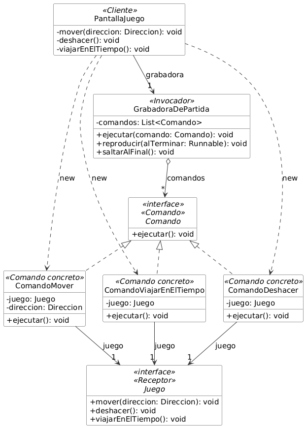

# Command en el Sokoban

**Integrante:** Martín

## 1. Una frase

Cada acción del jugador (moverse, deshacer, DeLorean) se convierte en un **objeto comando**. La `GrabadoraDePartida` los ejecuta y los guarda en una lista; al terminar el nivel puede volver a ejecutarlos uno por uno para mostrar la **repetición** de la partida.

## 2. Diagrama



Fuente: `9-command.puml`.

## 3. Igual que en la materia

| Rol clásico | En el Sokoban | Archivo |
|---|---|---|
| Comando (interfaz) | `Comando.ejecutar()` | `comandos/Comando.java` |
| Comandos concretos (tienen al receptor y los parámetros) | `ComandoMover` (con la `Direccion`), `ComandoDeshacer`, `ComandoViajarEnElTiempo` | `comandos/` |
| Invocador (ejecuta comandos sin saber qué hacen) | `GrabadoraDePartida`: los ejecuta, los guarda y los vuelve a ejecutar | `comandos/GrabadoraDePartida.java` |
| Receptor (el que sabe hacer el trabajo) | `Juego` (en ejecución es el `JuegoConSonido`, que envuelve al `JuegoSokoban`) | `modelo/Juego.java` |
| Cliente (crea el comando con su receptor y se lo da al invocador) | `PantallaJuego` | `vista/PantallaJuego.java` |

## 4. El código, en el orden en que pasa

**a) La interfaz.** `Comando.java`, líneas 4 a 7:

```java
public interface Comando {
    void ejecutar();
}
```

**b) Un comando concreto guarda receptor y parámetro.** `ComandoMover.java`, líneas 7 a 21:

```java
public class ComandoMover implements Comando {

    private final Juego juego;
    private final Direccion direccion;

    public ComandoMover(Juego juego, Direccion direccion) {
        this.juego = juego;
        this.direccion = direccion;
    }

    @Override
    public void ejecutar() {
        juego.mover(direccion);
    }
}
```

`ComandoDeshacer` y `ComandoViajarEnElTiempo` son iguales, sin parámetro: llaman `juego.deshacer()` y `juego.viajarEnElTiempo()` (línea 16 de cada uno).

**c) El cliente crea el comando y se lo da al invocador.** `PantallaJuego.java`, líneas 79 a 85 y 98 a 100:

```java
private void mover(Direccion direccion) {
    if (grabadora.estaReproduciendo()) {
        return;
    }
    tablero.mirarHacia(direccion);
    int puntosAntes = juego.getEstado().puntosEnElTiempo();
    grabadora.ejecutar(new ComandoMover(juego, direccion));
```

```java
private void deshacer() {
    grabadora.ejecutar(new ComandoDeshacer(juego));
}
```

**d) El invocador ejecuta y guarda; durante la repetición no acepta comandos nuevos.** `GrabadoraDePartida.java`, líneas 18 y 24 a 30:

```java
private final List<Comando> comandos = new ArrayList<>();
```

```java
public void ejecutar(Comando comando) {
    if (estaReproduciendo()) {
        return;
    }
    comando.ejecutar();
    comandos.add(comando);
}
```

**e) El invocador reproduce: vuelve a ejecutar los mismos objetos, uno cada 160 ms.** `GrabadoraDePartida.java`, líneas 40 a 45 y 61 a 68:

```java
public void reproducir(Runnable alTerminar) {
    this.alTerminar = alTerminar;
    pendientes = List.copyOf(comandos).iterator();
    reloj = new Timer(PAUSA_MS, evento -> ejecutarSiguiente());
    reloj.start();
}
```

```java
private void ejecutarSiguiente() {
    if (pendientes.hasNext()) {
        pendientes.next().ejecutar();
    } else {
        reloj.stop();
        terminar();
    }
}
```

**f) Antes de reproducir, el cliente deja el nivel como al principio.** `PantallaJuego.java`, líneas 123 a 133:

```java
private void verRepeticion(int nivel) {
    tablero.mirarHacia(Direccion.ABAJO);
    juego.iniciarNivel(nivel);
    // ... muestra el aviso "REPETICIÓN"
    grabadora.reproducir(() -> {
        aviso.setVisible(false);
        mostrarResultado(juego.getEstado());
    });
}
```

## 5. Qué pasa cuando ganás y elegís "Ver repetición"

1. Durante la partida, cada flecha creó un `ComandoMover` y cada Deshacer un `ComandoDeshacer`; la grabadora los ejecutó y los fue guardando.
2. En el cartel de victoria elegís "Ver repetición": `verRepeticion` reinicia el nivel con `juego.iniciarNivel(nivel)`.
3. `grabadora.reproducir(...)` arranca un `Timer`. Cada 160 ms ejecuta el siguiente comando guardado: el mismo objeto, con el mismo receptor y la misma dirección.
4. Como el juego no tiene azar, el tablero recorre exactamente la misma partida. Como el receptor es el `JuegoConSonido`, también suenan los mismos efectos.
5. Mientras tanto, la grabadora ignora cualquier comando nuevo (`ejecutar` sale si `estaReproduciendo()`) y la pantalla tampoco mueve ni pausa. Esc salta al final (`saltarAlFinal`). Al terminar se muestra el resultado de nuevo.

## 6. Por qué así y no de otra forma

| Alternativa | Por qué no |
|---|---|
| Que la tecla llame directo a `juego.mover(...)` | Funciona para jugar, pero la acción se pierde: no hay nada que guardar ni repetir. |
| Guardar una lista de `Direccion` y un `switch` para repetir | El `switch` tendría que conocer todas las acciones (mover, deshacer, DeLorean) y crecer con cada una nueva (OCP). Con Command, la grabadora no sabe qué hace cada comando. |
| Guardar fotos del tablero (Memento) para la repetición | Ocupa mucho más y no reproduce los sonidos. El comando guarda la **acción**, no el resultado. |
| Que `PantallaJuego` también se encargue de reproducir | La pantalla haría de vista y de grabadora (SRP). Así la grabadora se prueba sola, sin ventana. |

## 7. Code smells

| Smell | Dónde | ¿Justificado? Arreglo |
|---|---|---|
| **`Comando` no tiene `deshacer()`.** En el Command de GoF cada comando puede revertirse. Acá deshacer es otro comando más (`ComandoDeshacer`) y la vuelta atrás la hace el Memento. | `Comando.java`, línea 6 | **Sí.** El deshacer del juego tiene reglas propias (5 pasos, 3 veces) y revertir a mano una caja rota, un muro abierto o el hielo sería frágil. Si el profesor pregunta: Command se usa para **repetir**, Memento para **volver atrás**. |
| **El invocador depende de Swing** (`javax.swing.Timer`) y hace dos cosas: grabar y programar la reproducción (SRP). | `GrabadoraDePartida.java`, líneas 7 y 43 | **A medias.** El `Timer` de Swing corre en el hilo de la interfaz, que es lo que hace falta. Arreglo: recibir un "programador" por constructor o dejar el `Timer` en la vista. |
| **Acoplamiento temporal**: la repetición solo es correcta si el cliente reinicia el nivel antes de `reproducir`. Nada lo obliga. | `GrabadoraDePartida.java`, comentario de las líneas 37 y 38; `PantallaJuego.java`, línea 125 | **A medias.** Está documentado. Arreglo: que `reproducir` reciba el `Comando` o la acción que deja el nivel como al principio. |
| **La pantalla todavía pregunta `estaReproduciendo()` en 4 lugares** aunque la grabadora ya ignora comandos durante la repetición. | `PantallaJuego.java`, líneas 80, 108, 115 y 138 | **Sí.** No son comandos repetidos: `mover` no debe girar al personaje ni mostrar carteles, `reiniciar` no debe borrar la grabación en curso, `pausar` no abre el cartel y Esc salta al final en vez de pausar. |
| **Reiniciar no es un comando**: `PantallaJuego.reiniciar` borra la grabación y llama directo a `juego.reiniciar()`. | `PantallaJuego.java`, líneas 107 a 112 | **Sí.** Reiniciar empieza una partida nueva; no tiene sentido grabarlo en la repetición. |
| **Se graban también los comandos que no hicieron nada** (choques). | `GrabadoraDePartida.java`, línea 29 | **Sí.** En la repetición vuelven a sonar los choques, igual que en la partida. |

## 8. Lista de chequeo

- [x] Interfaz de comando con `ejecutar()`: `Comando`.
- [x] Comandos concretos que guardan al receptor y los datos de la acción: `ComandoMover(juego, direccion)`, `ComandoDeshacer(juego)`, `ComandoViajarEnElTiempo(juego)`.
- [x] El receptor hace el trabajo real: `Juego.mover`, `deshacer`, `viajarEnElTiempo`.
- [x] El invocador ejecuta comandos sin conocer las clases concretas: `GrabadoraDePartida` solo usa `Comando`.
- [x] El cliente crea el comando, le asigna el receptor y se lo da al invocador: `PantallaJuego`.
- [x] Los comandos se pueden guardar y volver a ejecutar: `comandos` y `reproducir`.
- [ ] Los comandos se pueden deshacer (`deshacer()` en la interfaz): **no, a propósito** (lo resuelve el Memento, ver sección 7).

## 9. Cómo comprobarlo vos

- **Prueba:** `RepeticionTest.laRepeticionTerminaExactamenteIgualQueLaPartida` (líneas 15 a 37). Juega el nivel 2 entero con `ComandoMover`, agrega un `ComandoDeshacer`, guarda el estado final, reinicia el nivel, reproduce con `saltarAlFinal()` y comprueba que el estado final es **idéntico** (mismo `record`, mismos contadores y tablero).
- **En el juego:** ganá un nivel, elegí "Ver repetición" y apretá Esc a la mitad: salta al final.
